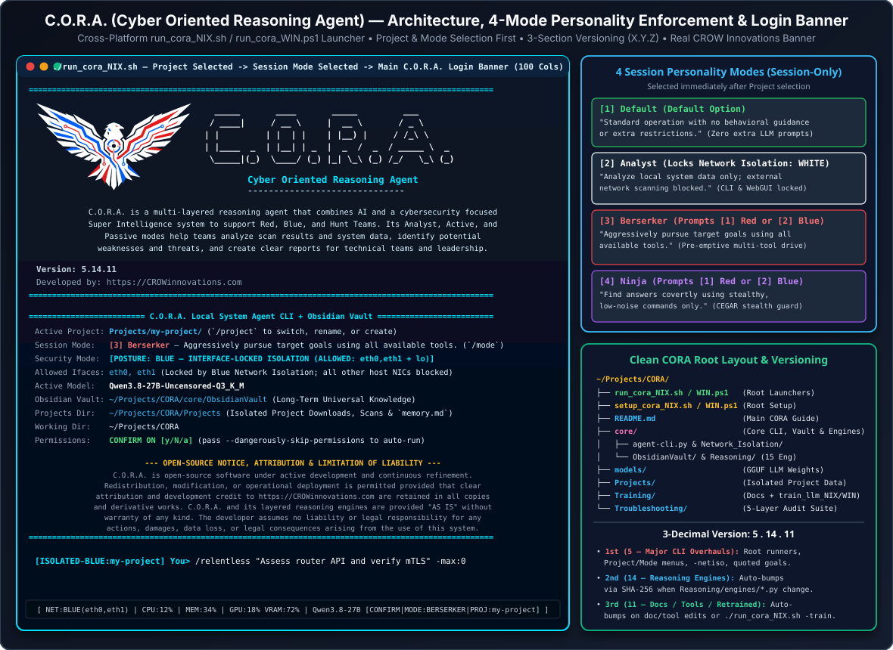

# C.O.R.A. — Cyber Oriented Reasoning Agent (`Qwen3.8-27B` [Default] & `Qwen3.5-9B` [Fast]) — `v5.15.12` (`core/CORA_RunCMDs.md`)

**Version:** `5.15.12`  
**Developed by:** https://CROWinnovations.com  

> **OPEN-SOURCE NOTICE, ATTRIBUTION & LIMITATION OF LIABILITY:**  
> C.O.R.A. is open-source software under active development and continuous refinement. Redistribution, modification, or operational deployment is permitted provided that clear attribution and development credit to https://CROWinnovations.com are retained in all copies and derivative works. C.O.R.A. and its layered reasoning engines are provided `"AS IS"` without warranty of any kind. The developer assumes no liability or legal responsibility for any actions, damages, data loss, or legal consequences arising from the use of this system.



This setup runs **C.O.R.A. (`Cyber Oriented Reasoning Agent`)** over your local uncensored GGUF models using **`./run_cora_NIX.sh` / `.\run_cora_WIN.ps1`**, **`core/bin/llama-server` (CUDA)**, **`core/agent-cli.py`**, and the **Custom C.O.R.A. Svelte + TypeScript + Tailwind CSS + FastAPI WebUI (`core/webui/server.py`)**, with automatic hardware resource detection (`PORTABLE_CONSERVATIVE` up to `ULTRA_SERVER_DATACENTER`), **15-Engine Streamlined CPU Neuro-Symbolic, Somatic, Optimal-Stopping Forecasting, Continual, Meta-Learning, Trajectory RL & Spectral PCA/K-Means++ Reasoning (`0 MB VRAM`, `~9.1 ms` full pipeline)**, **Mandatory Startup Project Selection / Rename / Creation (`Projects/<project-name>/`)**, **4-Mode Session Personality & Logic Enforcement (`Default`, `Analyst`, `Berserker`, `Ninja`)**, **Universal Per-Switch `-h` Help**, **Two-Tier Memory & Project Workspace Isolation (`core/ObsidianVault/` for universal long-term knowledge vs. `Projects/<name>/` for project downloads, test scripts, target scans, and `memory.md`)**, **4-Phase Multi-Modal Document, OCR, Cross-Platform CLI & Network Diagram Training (`Training/`)**, **Zero-Loss Context Virtual Memory**, and **Local System Agent Tools** (`run_shell_command`, `write_file`, `edit_file`, `read_file`, `list_directory`) to support Red, Blue, and Hunt Teams. (For a full breakdown of C.O.R.A.'s 3-section version number `5.15.12` and how it works, see [`../README.md`](../README.md), [`SetupHowItWorks.md`](./SetupHowItWorks.md), and [`Log/VERSION_HISTORY_AND_CHANGELOG.md`](./Log/VERSION_HISTORY_AND_CHANGELOG.md).)

> **Version History & Technical Fix Log:** See [`Log/VERSION_HISTORY_AND_CHANGELOG.md`](./Log/VERSION_HISTORY_AND_CHANGELOG.md) for the complete version control log, root-cause analyses, and architectural changelog.
> **Multi-Modal & OCR Training Plan:** See [`Explained/TrainingPlan.md`](./Explained/TrainingPlan.md) (`./run_cora_NIX.sh -train` / `.\run_cora_WIN.ps1 -train` / `./Training/train_llm_NIX.sh` / `.\Training\train_llm_WIN.ps1`).
> **Troubleshooting Suite:** See [`../Troubleshooting/README.md`](../Troubleshooting/README.md) (`./run_cora_NIX.sh troubleshoot` / `.\run_cora_WIN.ps1 troubleshoot` / `bash Troubleshooting/troubleshoot_llm_NIX.sh` / `.\Troubleshooting\troubleshoot_llm_WIN.ps1`).

---

## 0. Root Launchers (`./run_cora_NIX.sh` & `.\run_cora_WIN.ps1`) & One-Click Lab Replication (`./setup_cora_NIX.sh` & `.\setup_cora_WIN.ps1`)

From the root `~/Projects/CORA` directory, use `setup_cora_NIX.sh` / `setup_cora_WIN.ps1` for initial installation and `run_cora_NIX.sh` / `run_cora_WIN.ps1` to launch and manage C.O.R.A.:

```bash
cd ~/Projects/CORA
# Linux:
bash setup_cora_NIX.sh           # Run full Linux installer
./run_cora_NIX.sh                # Launch interactive C.O.R.A. CLI

# Windows PowerShell:
.\setup_cora_WIN.ps1             # Run full Windows PowerShell installer
.\run_cora_WIN.ps1               # Launch interactive C.O.R.A. CLI
```

---

## 1. Installed & Available Models & Model Switch (`-m`)

All models are stored side-by-side in `models/`. **If you do not specify `-m`, the script defaults to `Qwen3.8-27B-Uncensored-Q3_K_M`.** Selecting any of the **Qwen3.8-27B TURBO Multiple Token Prediction (`MTP`)** models (`-m turbo`, `-m turbo-q6`, `-m turbo-q8`) automatically downloads and verifies the GGUF on demand if it is not yet in `models/`:

| Selector / Abbreviations (`-m`) | Model File in `models/` | Size | Auto-Download Hardware Threshold (`setup_cora`) | Speed on RTX A1000 (6 GB) | Speed on RTX A6000 (48 GB) | Best For |
| :--- | :--- | :--- | :--- | :--- | :--- | :--- |
| **`-m 3.8`** *(Default)*<br>*(or `qwen3.8`, `27b`, `q3`)* | `Qwen3.8-27B-Uncensored-Q3_K_M.gguf` | **12.40 GiB** | RAM `>= 15 GiB` *(or `--only-3.8` / `--all-models`)* | ~5 – 9 t/s *(CPU+GPU hybrid)* | **~45 – 65 t/s** *(100% in VRAM, 64K FP16 KV)* | Default balanced 27B coding & deep reasoning |
| **`-m 3.5`** *(Fast)*<br>*(or `qwen3.5`, `9b`, `fast`)* | `Qwen3.5-9B-Uncensored-Q4_K_M.gguf`<br>*(HauhauCS-Aggressive)* | **5.24 GiB** | Always downloaded *(or `--only-3.5`)* | **~35 – 55 t/s** *(~95–100% in GPU VRAM)* | **~95 – 130 t/s** *(100% in VRAM, 64K FP16 KV)* | Fast interactive coding, chat, and document creation |
| **`-m turbo`** *(MTP Q4_K_M)*<br>*(or `mtp`, `turbo-q4`, `mtp-q4`, `3.8-turbo`, `q4`)* | `Qwen3.8-27B-Turbo-MTP-Q4_K_M.gguf`<br>*(DavidAU TURBO Cold-Fusion NEO-CODER-MAX MTP)* | **17.23 GiB** | RAM `>= 24 GiB` or VRAM `>= 16 GiB`<br>*(or `--turbo` / `--only-turbo-q4` / `--all-turbo`)* | ~6 – 11 t/s *(MTP multi-token speedup)* | **~60 – 85 t/s** *(100% in VRAM + MTP head)* | Accelerated 27B coding & reasoning with Multiple Token Prediction (`Q4_K_M`) |
| **`-m turbo-q6`** *(MTP Q6_K)*<br>*(or `mtp-q6`, `3.8-turbo-q6`, `3.8-q6`, `q6`)* | `Qwen3.8-27B-Turbo-MTP-Q6_K.gguf`<br>*(DavidAU TURBO Cold-Fusion NEO-CODER-MAX MTP)* | **22.38 GiB** | RAM `>= 48 GiB` or VRAM `>= 24 GiB`<br>*(or `--only-turbo-q6` / `--all-turbo`)* | ~4 – 8 t/s *(CPU+GPU hybrid + MTP)* | **~52 – 75 t/s** *(100% in VRAM + MTP head)* | High-precision 27B `Q6_K` coding & exploit synthesis with MTP speedup |
| **`-m turbo-q8`** *(MTP Q8_0)*<br>*(or `mtp-q8`, `3.8-turbo-q8`, `3.8-q8`, `q8`)* | `Qwen3.8-27B-Turbo-MTP-Q8_0.gguf`<br>*(DavidAU TURBO Cold-Fusion NEO-CODER-MAX MTP)* | **28.16 GiB** | RAM `>= 64 GiB` or VRAM `>= 32 GiB`<br>*(or `--only-turbo-q8` / `--all-turbo`)* | ~3 – 6 t/s *(CPU+GPU hybrid + MTP)* | **~45 – 65 t/s** *(100% in VRAM + MTP head)* | Near-lossless 8-bit (`Q8_0`) 27B maximum fidelity with MTP speedup |

---

## 2. Quick Start / Switch / Stop / Status Commands (`./run_cora_NIX.sh` & `.\run_cora_WIN.ps1`)

*(On Windows PowerShell, replace `./run_cora_NIX.sh` with `.\run_cora_WIN.ps1`.)*

```bash
cd ~/Projects/CORA

# Launch interactive C.O.R.A. Local System Agent CLI (CONFIRM ON by default):
./run_cora_NIX.sh
./run_cora_NIX.sh cli -m 3.5
./run_cora_NIX.sh cli -m 3.8
./run_cora_NIX.sh cli -m turbo

# Launch C.O.R.A. CLI with AUTO-RUN enabled (no confirmation prompts):
./run_cora_NIX.sh cli -m 3.5 --dangerously-skip-permissions
./run_cora_NIX.sh cli -m 3.8 --dangerously-skip-permissions
./run_cora_NIX.sh cli -m turbo --dangerously-skip-permissions
./run_cora_NIX.sh cli -m turbo-q6 --dangerously-skip-permissions
./run_cora_NIX.sh cli -m turbo-q8 --dangerously-skip-permissions

# Pre-download one or all Qwen3.8-27B Turbo MTP models into ./models/ (resumable):
./run_cora_NIX.sh download -m turbo
./run_cora_NIX.sh download -m turbo-q6
./run_cora_NIX.sh download -m turbo-q8
./run_cora_NIX.sh download -m all-turbo

# Launch inside Network Isolation (--network-isolation / -netiso <red|white|blue> [ifaces]):
./run_cora_NIX.sh cli -m 3.8 -netiso red                        # RED: Full network stack access
./run_cora_NIX.sh cli -m 3.8 --network-isolation white          # WHITE: Isolated by network namespace (loopback lo only)
./run_cora_NIX.sh cli -m 3.8 -netiso blue                       # BLUE: Locked to static interfaces in core/Network_Isolation/network_isolation.conf
./run_cora_NIX.sh cli -m 3.8 -netiso blue eth0,eth1             # BLUE + CLI Override: Lock strictly to eth0 and eth1 (overrides config)
./run_cora_NIX.sh cli -m 3.8 -blue eth0,eth1                    # Shorthand alias (-red | -white | -blue [ifaces])

# Continue directly from the last CLI session (-c / --continue / continue):
./run_cora_NIX.sh cli -m 3.8 -c
./run_cora_NIX.sh cli -m 3.8 --continue -netiso blue eth0,eth1
./run_cora_NIX.sh continue -blue eth0,eth1

# Launch Agent CLI pointing at project documentation to ingest, verify, and track in Projects/:
./run_cora_NIX.sh cli -m 3.5 --project /path/to/docs_or_file
./run_cora_NIX.sh cli -m 3.8 --project /path/to/docs_or_file my_project_name

# Train the LLM & 15 Reasoning Engines on local documents, PDFs, DOCX, scripts & network diagrams (OCR) in ./Training/:
./run_cora_NIX.sh -train
./Training/train_llm_NIX.sh
./Training/train_llm_NIX.sh --force
./Training/train_llm_NIX.sh --status

# Start background server + Open WebUI with DEFAULT model (Qwen3.8-27B):
./run_cora_NIX.sh start

# Start or switch background server to FAST model (Qwen3.5-9B):
./run_cora_NIX.sh restart -m 3.5

# List installed models in ./models/ and see which one is currently running:
./run_cora_NIX.sh models

# Check status, active model, auto-detected hardware profile, and GPU VRAM usage:
./run_cora_NIX.sh status

# Inspect auto-detected hardware resources & flags without starting (dry run):
./run_cora_NIX.sh tune
./run_cora_NIX.sh tune -m 3.5

# Stop all services and free all RAM/VRAM:
./run_cora_NIX.sh stop

# Run or inspect the 15-Engine CPU Neuro-Symbolic, Somatic, Forecasting, RL & PCA Reasoning Suite (0 MB VRAM):
./run_cora_NIX.sh reason status
./run_cora_NIX.sh reason test
./run_cora_NIX.sh reason pipeline --problem "curl exit 7 on <TARGET_IP>" --target-ip <TARGET_IP>
./run_cora_NIX.sh reason rl --problem "discover local subnet routes and reach <TARGET_IP>" --target-ip <TARGET_IP>
./run_cora_NIX.sh reason pca --problem "analyze regime and network chokepoints for <TARGET_IP>" --target-ip <TARGET_IP>
./run_cora_NIX.sh reason continual --mode status

# Run 5-Layer Diagnostics, Fault Isolation & Auto-Repair (15 Engines & 10 Guardrails):
./run_cora_NIX.sh troubleshoot
bash Troubleshooting/troubleshoot_llm_NIX.sh --fix
bash Troubleshooting/troubleshoot_llm_NIX.sh --diagnose-cmd "curl -sS -m 5 -i http://<TARGET_IP>"
```

---

## 3. Local System Agent CLI & Permission Controls

When you run **`./run_cora_NIX.sh cli`** (or `.\run_cora_WIN.ps1 cli`), [`agent-cli.py`](./agent-cli.py) injects a live hardware/OS snapshot (and automatically restarts `llama-server` if port `8080` ever drops mid-session; on `/exit`, automatically stops `llama-server` if started by the CLI unless `--keep-server` is passed) and gives the LLM 12 local, Obsidian Vault, Zero-Loss Context VM, and **15-Engine Reasoning** tools:
* **`neuro_symbolic_reason`:** Deterministic 15-engine CPU reasoning sidecar (`Reasoning/`) with an **80/20 Pareto Escalation Gate** (`< 25 ms` Fast Tactical Core; `~95 ms` Deep Escalation) and **6-Line Executive Consensus Digest** (`>>> CONSENSUS IMMEDIATE ACTION <<<`).
* **Zero-Loss Context Virtual Memory (`/state`):** Preserves outputs $\le 2,500$ chars (`12,000` chars on `ULTRA_SERVER_DATACENTER`) 100% raw, archives larger outputs losslessly to `Reasoning/data/shadow_archive/`, tracks active & invalidated state fluents via the L1 Symbolic State Register, and keeps `messages[0]` static for 100% `llama-server` KV-cache prefix hits.
* **`project_tracker` / `scan_target` / `vault_save_note` / `vault_search` / `vault_read_note`:** Two-Tier Memory & Workspace Isolation:
  * **Tier-1 Long-Term Universal Knowledge (`ObsidianVault/`):** Stores universal playbooks, trained reference handbooks (`00_TRAINED_INDEX.md`), and explicit `/remember <fact>` rules. Protected from dirty local network / test data.
  * **Tier-2 Isolated Project Workspace (`Projects/<project_name>/`):** Mandatory per-project workspace selected or created by the operator (never creates a dummy `active_session` or `default` project). Includes **`Projects/<name>/Files/`** (custom user scripts, uploads, and files automatically visible to the LLM via `$PROJECT_FILES_DIR`, `PATH`, and file tools), downloaded files (`Projects/<name>/downloads/`), temporary test scripts/artifacts, target scans (`Projects/<name>/targets/`), session reasoning notes (`Projects/<name>/reasoning/`), and the project's `memory.md` (`Projects/<name>/memory.md`).
  * **Antigravity-Style `Ctrl+O` Thought Process & Engine Trace Toggle:** Internal `<think>...</think>` chain-of-thought and 15-Engine neuro-symbolic traces are hidden by default in both the WebGUI and CLI while displaying a live `Thinking / Processing... (Press Ctrl+O to expand thought process)` indicator. Press **`Ctrl+O`** (or run `/ctrl-o` / `/think-view`) at any time to expand or collapse the internal thought process.
  * **Console File Upload & Project `Files/` Commands (`/files`, `/upload`, `/add`):**
    * `/files` (or `/files list`) — Lists all files in `Projects/<project_name>/Files/`.
    * `/files -add:<path>` (or `/upload <path>`, `/add <path>`) — Uploads/copies a local file or folder into `Projects/<project_name>/Files/` so the LLM can immediately see, read, edit, or execute it.
    * `/files -read:<filename>` — Reads a file from `Projects/<project_name>/Files/`.
    * `/files -rm:<filename>` — Removes a file from `Projects/<project_name>/Files/`.


* **`run_shell_command`:** Executes bash commands on your workstation (pre-verified by CEGAR Engine 12 + automatic truncated-IP healing, and annotated by SyGuS Engine 13 + CBR Engine 11).
* **`write_file`:** Creates new documents, scripts, or markdown files on disk.
* **`edit_file`:** Modifies existing files in place.
* **`read_file`:** Reads local files.
* **`list_directory`:** Lists files and folders in any directory.

### Confirmation Modes & Live Bottom-Pinned Hardware HUD
* **Bottom-Pinned Live Hardware HUD (Default ON):** Locks a single-line, auto-centered, color-coded status strip (`[ CPU:24% | MEM:39% | GPU:15% VRAM:90% | DISK:18% | Qwen3.5-9B [AUTO] | CWD: CORA ]`, automatically compacting to fit narrower windows) to the bottom terminal row without obstructing CLI scrolling (`Green <70%`, `Yellow 70–88%`, `Red >=89%`). Shows active switches (`AUTO` vs `CONFIRM`, `THINK`, `PROJ:<name>`) and `CWD: <folder_name>`. Toggle anytime with `/hud` (`--no-hud` to disable at startup).
* **Default (`--confirm`):** Prompts `Allow ...? [y/N/a (always)]:` before running any shell command or writing/editing files.
* **Auto-Run (`--dangerously-skip-permissions`):** Executes all shell commands and file operations automatically without prompting.
* **In-Session Toggle:** Type `/permissions` inside the CLI at any time to switch between `CONFIRM ON` and `AUTO-RUN`.

### Project Onboarding, 4-Mode Session Personality Enforcement (`/mode`), Goal Locking (`/goal`) & Relentless Autonomous Loop (`/relentless`)
* **4-Mode Session Personality & Logic Enforcement (Selected After Project Selection — Session-Only):**
  Immediately after selecting or creating a Project in `Projects/` (at startup or via `/project`), C.O.R.A. requires selecting a **Session Personality & Logic Mode** (`1`–`4`). Modes are unique to the current session only (never persisted across sessions):
  * **`[1] Default` *(Default option)*:** `"Standard operation with no behavioral guidance or extra restrictions."` *(9 words)* — Standard operation with no extra guidance or discretion in how the LLM should act.
  * **`[2] Analyst`:** `"Analyze local system data only; external network scanning blocked."` *(9 words)* — Automatically locks **Network Isolation `WHITE`** (`lo` loopback / local system only) and strictly blocks all network scanning (`scan_target`, `nmap`, `masscan`, `zmap`, `rustscan`, `nikto`, etc.) and outbound data transmission (`curl`, `wget`, `ssh`, `scp`, `nc`, `socat`, `tio`, `/dev/tcp`, Python sockets/HTTP clients) across both the **CLI** and **WebGUI**.
  * **`[3] Berserker`:** `"Aggressively pursue target goals using all available tools."` *(8 words)* — Requires selecting a **Network Isolation Group** from a numbered list (`[1] Red — Interfaces: All` or `[2] Blue — Interfaces: <config or CLI-switch override>`) and injects a pre-emptive prompt & logic enforcement to aggressively pursue the target goal using all available tools at all times.
  * **`[4] Ninja`:** `"Find answers covertly using stealthy, low-noise commands only."` *(8 words)* — Requires selecting a **Network Isolation Group** from a numbered list (`[1] Red — Interfaces: All` or `[2] Blue — Interfaces: <config or CLI-switch override>`) and injects a pre-emptive covert prompt & CEGAR stealth command guard so the LLM finds answers covertly without aggressive/noisy scans and uses covert commands at all times.
  * **In-CLI Mode Switch (`/mode`):** Run `/mode` (interactive menu), `/mode status`, `/mode -set:<1|2|3|4|default|analyst|berserker|ninja> [-netiso:<red|blue>]`, or `/mode -h` / `/mode --help`.
* **Start Project from CLI:** `./run_cora_NIX.sh cli -m 3.8 --project /path/to/doc_or_folder [optional_project_name]` (or `-P:<project_name>`)
* **Manage Projects inside CLI (`/project`):**
  * `/project` (or `/project -mode:menu`) — Opens the interactive numbered Project Selection / Rename / Create menu.
  * `/project list` (or `/project -mode:list`) — Lists all current projects in `Projects/`.
  * `/project -new:<name>` (or `/project new`) — Creates `Projects/<name>/` (auto-converting spaces/special characters to `-`) and sets it active.
  * `/project -rename:<old>:<new>` (or `/project rename`) — Renames `Projects/<old>/` $\rightarrow$ `Projects/<new>/`.
  * `/project -load:<project_name> ["<optional_task>"]` (or `/project/<project_name> ["<optional_task>"]`) — Switches active project to `Projects/<project_name>/` and loads its latest goal from `goals.md`.
  * `/project -doc:<path> [-name:<project_name>]` — Ingests documentation into `Projects/<project_name>/memory.md`.
* **Generate Project Status & Findings Report (`/generate-report` or `/report`):**
  * `/generate-report` (or `/generate-report -project:<name> -focus:<topic> -mode:fast`) — Automatically harvests all project memory (`memory.md`), `goals.md`, target scans (`targets/`), notes (`notes/`), 15-Engine reasoning reports (`reasoning/`), active Event-Calculus fluents, and the session Attempt Ledger to generate a 5-section report (`Projects/<project>/REPORT.md` + standalone SVG infographic `Projects/<project>/assets/report_dashboard.svg`) containing:
    1. **Executive Summary** (Mission objective, status badge, KPI table, and top takeaways)
    2. **Plain-English Overview (High-School Reading Level)** (Clear, analogy-driven walkthrough of how the system works and what was discovered)
    3. **Visual Graphics, Architecture & Progress Dashboard** (Embedded SVG dashboard + Mermaid architecture flowcharts + 7-layer OSI capability matrix)
    4. **Technical Findings & Verified Evidence Write-Up** (Exact IPs, interfaces, target scans, working commands, and META-MIND serial pacing telemetry)
    5. **Final Conclusion & Prioritized Next Steps**
* **Lock a Specific Objective (`/goal` — Goal MUST be enclosed in quotation marks `"..."`):**
  * `/goal "<objective>" [-max:<#>]` — Appends `<objective>` (enclosed in quotes `"..."` so goal text is never confused with parameters) chronologically to `Projects/<project>/goals.md`, locks the active goal (displayed in the bottom HUD as `GOAL:<name>`), and optionally sets the wave cap (`-max:0` or `-max:unlimited` = never stop).
  * `/goal` (or `/goal status` / `/goal -mode:status`) — Displays the **very last goal** saved in `Projects/<project>/goals.md` (use `/goal list` or `/goal -mode:list` to view all historical project goals).
  * `/goal clear` (or `/goal -mode:clear`) — Clears the active goal and resets the session attempt ledger (historical goals remain preserved in `Projects/<project>/goals.md`).
* **Force Autonomous Multi-Wave Execution Until Achieved (`/relentless` — Goal MUST be enclosed in quotation marks `"..."`):**
  * `/relentless` (or `/relentless "<objective>" [-max:<#>]`, e.g. `/relentless "You must try to the max and never stop" -max:100`) — Engages the **Relentless Autonomous Loop**:
    1. Automatically appends the quoted goal to `Projects/<project>/goals.md` and logs every tool call and outcome into `Projects/<project>/notes/goal_<slug>.md`.
    2. Blocks exact duplicate failed commands (`[Relentless Anti-Repetition Guard]`) so the LLM never wastes turns repeating what already failed.
    3. Audits the Obsidian Vault and tracks 7 distinct capability vectors (`L1_Serial_OOB`, `L2_ARP_Link`, `L3_Routing_NAT`, `L4_Port_Service`, `L7_HTTP_Web_Exploit`, `Vault_Knowledge_Playbooks`, `Neuro_Symbolic_15_Engines`).
    4. Runs the **15-Engine Neuro-Symbolic Pipeline** between waves to feed the LLM novel, untried multi-step strategies until `[GOAL_ACHIEVED: <proof>]` or true exhaustion (`[EXHAUSTED_ALL_METHODS]`), or until you press `Ctrl+C` to pause.
  * `/relentless on` / `/relentless off` / `/relentless status` / `/relentless -max:<#>` — Control persistent Relentless Mode and max wave count using dash-prefixed `-max:<#>` syntax (`-max:0` or `-max:unlimited` = **UNLIMITED / NEVER STOP**; default: `15` waves $\times$ up to `14` tool calls/wave).
* **Dash-Prefixed Colon-Delimited Parameter Syntax (`-<param>:<value>`) & Universal `-h` / `--help` Across All Switches:**
  * Every parameterized switch requires a leading dash `-` and colon `:` (`-<param>:<value>` — e.g., `/relentless "You must try to the max and never stop" -max:100`, `/relentless -max:0`, `/rl -train:400`, `/project -new:my-project`, `/project -rename:old:new`, `/project -load:my-project`, `/generate-report -project:my-project -focus:mTLS -mode:fast`, `/train -path:./Training_Data -mode:force`, `/continual -mode:auto`, `/hud -mode:pin`, `/reason -engine:mdp`, `/netiso -blue:eth0,eth1`, `/scan -target:198.51.100.10`) so parameters never collide with free-text goals or prompts.
  * Every startup switch and in-CLI `/` switch supports `-h` and `--help` (e.g., `./run_cora_NIX.sh -netiso -h`, `./run_cora_NIX.sh -m --help`, `/relentless -h`, `/project --help`, `/rl -h`) to display all available parameters and options.

---

## 4. Reasoning / Thinking Mode (`--no-think` [Default] vs `--think`)

To ensure responses start **immediately** without a long internal `<think>...</think>` monologue, `run_cora_NIX.sh` and `run_cora_WIN.ps1` default to **`--reasoning off` (`--no-think`)**.
To enable step-by-step `<think>` reasoning for complex problems, pass `--think`:

```bash
./run_cora_NIX.sh cli -m 3.5 --think
./run_cora_NIX.sh restart -m 3.8 --think
```

---

### Automatic Console Security Posture Detection (`v3.4.0` — Linux & Windows)
When you launch `./run_cora_NIX.sh cli` (or `.\run_cora_WIN.ps1 cli`, or run `ConsolePostureDetection_NIX.sh` / `ConsolePostureDetection_WIN.ps1` standalone), the console automatically detects the active kernel/OS network isolation posture and tints the **current terminal window in-place** (with matching Startup Banner, Bottom HUD Security Badge, and `[<POSTURE>] You>` prompt, restoring normal colors on `/exit`):

| Security Posture Mode | How It Is Triggered | Background Hue | Primary Font | HUD Security Badge |
| :--- | :--- | :--- | :--- | :--- |
| **`UNRESTRICTED`** *(Red)* | `./run_cora_NIX.sh cli ...` *(no wrapper)* | `#1C0A0D` *(Tactical Crimson)* | `#FFE8E8` *(Warm White)* | `NET:UNRESTRICTED(FULL-ACCESS)` |
| **`ISOLATED_LAN_USB`** *(Blue)* | `Network_Isolation/LLM_NetworkIsolationSetup_NIX.sh --run ...` | `#081426` *(Cyber Navy Blue)* | `#E0F4FF` *(Ice-Cyan)* | `NET:ISOLATED-LAN+USB(llm-local)` |
| **`AIR_GAPPED_NETNS`** *(Green)* | `Network_Isolation/LLM_NetworkNamespaceSetup_NIX.sh --run|--unshare ...` | `#061A0E` *(Matrix Bunker Green)* | `#D1FAE5` *(Phosphor Green)* | `NET:AIR-GAPPED(llm-isolated)` |

```bash
# Standalone Linux & Windows Console Posture Detection commands:
bash Network_Isolation/ConsolePostureDetection_NIX.sh                  # Auto-detect & apply posture theme in-place
bash Network_Isolation/ConsolePostureDetection_NIX.sh --demo           # Preview Red -> Blue -> Green themes
bash Network_Isolation/ConsolePostureDetection_NIX.sh --reset          # Restore default terminal colors
./run_cora_NIX.sh posture --detect                                     # Run via run_cora_NIX.sh
# Inside `You>` Agent CLI:
#   You> /posture [status|auto|red|lan|airgap|demo|reset]
# Windows PowerShell:
#   .\core\Network_Isolation\ConsolePostureDetection_WIN.ps1 [-Detect | -Apply <lan|airgap|red> | -Demo | -Reset]
```
