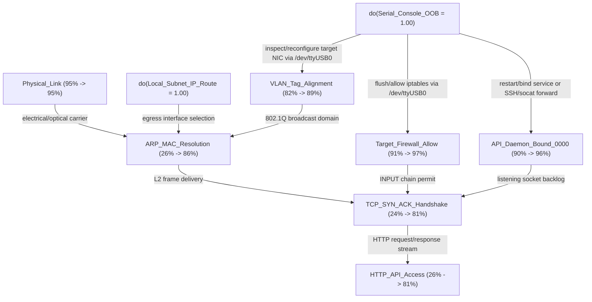

# pipeline15_target_ip_http_api_unreachable

> **Engine:** `neuro_symbolic_pipeline_15` | **Summary:** 15-Engine Neuro-Symbolic Synthesis for <TARGET_IP>: Consensus `tio -b 115200 --mute --script-run once --script 'write("ip -4 addr; ss -tulpn; iptables -L -n\r"); while read(4096, 500) > 0 do end; exit(0)' /dev/ttyUSB0`, RL Next `tio --script 'write("id\r\nip -br addr\r\nss -tulpn\r\n"); while read(4096, 600) > 0 do end; exit(0)' /dev/ttyUSB0` (Q*=+30.4), K-Means Cluster `C1_OOB_SERIAL_LOOPBACK_APPLIANCE`, Top Cause `service_on_nonstandard_port_or_tls` (30%)  
> **Backlink:** [[00_MEMORY_INDEX]] | **Updated:** `2026-10-25 14:50:17`

## 15-Engine Neuro-Symbolic, RL World-Model & PCA/K-Means++ Synthesis for `<TARGET_IP>` (`[STREAMLINED_15_ENGINE_CORE]`)
### Layer 5 Streamlined Executive Digest (6-Line LLM Fast-Read)
1. [VERDICT]        `tio -b 115200 --mute --script-run once --script 'write("ip -4 addr; ss -tulpn; iptables -L -n\r"); while read(4096, 500) > 0 do end; exit(0)' /dev/ttyUSB0` (Tier: `STREAMLINED_15_ENGINE_CORE`, CEGAR Blocked: `False`)
2. [REGIME & GATE]  Cluster `C1_OOB_SERIAL_LOOPBACK_APPLIANCE` (`MANIFOLD_INLIER`, Silhouette `0.451`) | DST Conflict K=0.000, Ignorance=0.100
3. [ROOT CAUSE]     `service_on_nonstandard_port_or_tls` (30.1%) | Causal Lift: `26.0% -> 81.3%` | Somatic Valence: `+0.685`
4. [RL & H-MDP]     State `C1_OOB_SERIAL_LOOPBACK_APPLIANCE::STAGE_2_OOB_SERIAL_UNLOCK` | Pessimistic Q_LCB=`+30.34` (exploration=0.0) | H-MDP Stop: `HOLD_OPTIMAL_TACTIC_LINE`
5. [NEXT FORECAST]  If exit==0 -> `tio -b 115200 --mute --script-run once --script 'write("iptables -I INPUT -j ACCEPT; sysctl -w net.ipv4.ip_forward=1\r"); while read(4096, 500) > 0 do end; exit(0)' /dev/ttyUSB0` | If exit!=0 -> `nmap -Pn -sT -p 22,80,443,5000,6000,8000,8080,8443,9000 <TARGET_IP>`
6. [CALIBRATION]    Hedge Top=`mdp_tactical` (Brier `0.105`, ECE `4.7%`, Continual Mode `AUTO`)

> **`>>> CONSENSUS IMMEDIATE ACTION <<<`**: `tio -b 115200 --mute --script-run once --script 'write("ip -4 addr; ss -tulpn; iptables -L -n\r"); while read(4096, 500) > 0 do end; exit(0)' /dev/ttyUSB0`
> **Arbiter Rationale**: Preconditions satisfied & CEGAR-verified; Hedge-weighted H-MDP Bellman policy `Out-of-Band_Access` ($Q^*(s,a)=250.7$, $w=1.88$) & RL $Q_{\text{LCB}}=+30.3$ align with top cause `service_on_nonstandard_port_or_tls` (30%) | [CBR Hint CBR-005: `tio -b 115200 --mute --script-run once --script 'write("ip -4 addr; ss -tulpn; iptables -L -n\r"); while read(4096, 500) > 0 do end; exit(0)' /dev/ttyUSB0`].
> **Engine 19 RL 3-Step Trajectory (`C1_OOB_SERIAL_LOOPBACK_APPLIANCE::STAGE_2_OOB_SERIAL_UNLOCK`)**: **Step 1** ($Q_{\text{LCB}}=+30.3$): `tio --script 'write("id\r\nip -br addr\r\nss -tulpn\r\n"); while read(4096, 600) > 0 do end; exit(0)' /dev/ttyUSB0` $\rightarrow$ **Step 2** ($Q_{\text{LCB}}=+23.0$): `curl -sS -k -L -i --max-time 10 http://<TARGET_IP>/`
> **Engine 15 Speculative Next-Tool Forecast ($t+1$)**: If `exit_code == 0` $\rightarrow$ `tio -b 115200 --mute --script-run once --script 'write("iptables -I INPUT -j ACCEPT; sysctl -w net.ipv4.ip_forward=1\r"); while read(4096, 500) > 0 do end; exit(0)' /dev/ttyUSB0` | If `exit_code != 0` $\rightarrow$ `nmap -Pn -sT -p 22,80,443,5000,6000,8000,8080,8443,9000 <TARGET_IP>`
> **Engine 20 PCA & K-Means++ Regime**: **`C1_OOB_SERIAL_LOOPBACK_APPLIANCE`** (`MANIFOLD_INLIER`, Silhouette `0.451`, Top-3 PCA Var `68.6%`) | **Chokepoint**: `Node:<TARGET_IP>`
> **Somatic Gut Valence (`Engine 7`)**: **`+0.685`** (`SOMATIC_BREAKTHROUGH_RESONANCE`) | **Optimal Stopping (`Engine 15`)**: **`HOLD_OPTIMAL_TACTIC_LINE`** ($V_{\text{cont}}=250.69$ vs $V_{\text{pivot}}=237.48$)

- **1. Topology & Geometric Containment (`Engines 1, 2, 9, 13`)**: `<TARGET_IP>` is **DISJOINT** from local L2 subnet (Supernet `0.0.0.0/0`, Holding Fluents=`2`, Vault Notes=`[[00_TRAINED_INDEX]]`, `[[commands/trained_unix_and_linux_system_administration_handbook]]`, `[[reasoning/pipeline15_target_ip_http_api_unreachable]]`).
- **2. Root-Cause, Epistemic Conflict & Causal Lift (`Engines 4, 5, 10`)**: Top Cause **`service_on_nonstandard_port_or_tls`** (**30.1%**, Entropy `2.18b`) | DST Conflict $K=`0.000`$, Ignorance $m(\Theta)=`0.100`$ | Causal `do(X)` Lift: **`26.0%` $\rightarrow$ `81.3%`**.
- **3. Pre-Verification & Failure Fingerprints (`Engines 11, 12`)**: CEGAR verified `4` candidate commands | CBR matched `2/14` failure rules.
- **4. Tactical Bellman H-MDP & Trajectory RL (`Engines 15, 19`)**: H-MDP `Out-of-Band_Access -> tio` ($Q^*=250.69$) | RL `5200` eps trained.
- **5. Continual Plasticity & Hedge Meta-Arbiter (`Engines 16, 17`)**: Mode=`AUTO` (Passes=`1`) | Brier=`0.105` (ECE `4.7%`).

---

# Stage 1: Associative Spreading Activation & Bipartite Vault Graph
## Associative Spreading Activation & Bipartite Vault Graph
- **Query / Context:** Target HTTP API probe failed with curl exit status 7; out-of-band serial console is available. <TARGET_IP> 
- **Bipartite Graph Scale:** `1218 nodes` (`361 Vault notes` + `857 extracted entities/concepts`), `3153 associative edges`
- **Matched Seed Activations:** `93 nodes` (PageRank damping $\alpha = 0.82$)

## 1. Top Activated Obsidian Vault Notes (Personalized PageRank)
| Rank | Obsidian Note | Category | Activation | Key Connected Concepts | Summary |
| :--- | :--- | :--- | :--- | :--- | :--- |
| **#1** | `[[00_TRAINED_INDEX]]` | `root` | **`0.1180`** | `0.0.1.33`, `0.0.100.4`, `0.15.0.2`, `1.0.0.0` | 00_TRAINED_INDEX |
| **#2** | `[[commands/trained_unix_and_linux_system_administration_handbook]]` | `commands` | **`0.0259`** | `0.11.25.39`, `0.5.0.1`, `1.0.0.0/8`, `1.174.2.19` | commands/trained_unix_and_linux_system_administration_handbook |
| **#3** | `[[reasoning/pipeline15_target_ip_http_api_unreachable]]` | `reasoning` | **`0.0223`** | `0.0.1.33`, `0.0.100.4`, `0.11.25.39`, `0.15.0.2` | 20-Engine Neuro-Symbolic Synthesis for <TARGET_IP>: Consensus `tio -b 115200 --m |
| **#4** | `[[knowledge/trained_unix_and_linux_system_administration_handbook]]` | `knowledge` | **`0.0213`** | `0.11.25.39`, `0.5.0.1`, `1.0.0.0/8`, `1.174.2.19` | knowledge/trained_unix_and_linux_system_administration_handbook |
| **#5** | `[[reasoning/pipeline15_target_ip_l2_l3_routing_blackhole]]` | `reasoning` | **`0.0192`** | `0.0.1.33`, `0.0.100.4`, `0.11.25.39`, `0.15.0.2` | 20-Engine Neuro-Symbolic Synthesis for <TARGET_IP>: Consensus `ip neigh show <TA |
| **#6** | `[[commands/tio_serial_playbook]]` | `commands` | **`0.0163`** | `/dev/ttyusb0`, `/dev/ttyusb1`, `serial`, `tio` | Non-interactive tio 3.9 Lua --script patterns for logging into and running comma |

## 2. Discovered Cross-Note Bridge Concepts (Lateral Conceptual Connectors)
| Bridge Concept | Type | Activation | Notes Linked | Connected Vault Notes |
| :--- | :--- | :--- | :--- | :--- |
| **`serial`** | `concept` | `0.0127` | `59` | `[[commands/tio_serial_playbook]]`, `[[commands/trained_bcf_cne_basics]]`, `[[commands/trained_cqc001_e020_m020_ntfs_cheat_sheets]]`, `[[commands/trained_cqc001_e020_m060_s010_i020_bypassexam_x060_c010_exhibit1]]` |
| **`powershell`** | `concept` | `0.0095` | `75` | `[[00_TRAINED_INDEX]]`, `[[commands/trained_apt28-center-of-storm-2017_mandiant]]`, `[[commands/trained_basic_survey_commands]]`, `[[commands/trained_bcf_cne_basics]]` |
| **`netstat`** | `concept` | `0.0074` | `55` | `[[commands/trained_basic_survey_commands]]`, `[[commands/trained_bcf_cne_basics]]`, `[[commands/trained_bcf_windows_live_response]]`, `[[commands/trained_bcf_windows_process_investigation]]` |
| **`curl`** | `concept` | `0.0073` | `13` | `[[commands/curl_playbook]]`, `[[commands/trained_cqc001_e040_m005_powershell_comparison]]`, `[[commands/trained_operator-handbook-search_copy_paste]]` |
| **`wmic`** | `concept` | `0.0058` | `41` | `[[00_TRAINED_INDEX]]`, `[[commands/trained_auditpol_cmds]]`, `[[commands/trained_basic_survey_commands]]`, `[[commands/trained_bcf_windows_process_investigation]]` |
| **`tio`** | `concept` | `0.0056` | `7` | `[[commands/tio_serial_playbook]]`, `[[commands/trained_lte_mobile_optimization-a_definitive_guide_wp_en_5216-2018-52_v0]]`, `[[knowledge/trained_lte_mobile_optimization-a_definitive_guide_wp_en_5216-2018-52_v0]]` |

## 3. Multi-Hop Conceptual Leap Pathways Across Categories
1. *(1-hop bridge)*: `[[00_TRAINED_INDEX]]` $\leftrightarrow$ `[[commands/trained_unix_and_linux_system_administration_handbook]]`
2. *(1-hop bridge)*: `[[00_TRAINED_INDEX]]` $\leftrightarrow$ `[[reasoning/pipeline15_target_ip_http_api_unreachable]]`
3. *(1-hop bridge)*: `[[00_TRAINED_INDEX]]` $\leftrightarrow$ `[[knowledge/trained_unix_and_linux_system_administration_handbook]]`
4. *(1-hop bridge)*: `[[00_TRAINED_INDEX]]` $\leftrightarrow$ `[[reasoning/pipeline15_target_ip_l2_l3_routing_blackhole]]`

---

# Stage 2: Geometric & Subnet Constraint Analysis
## Geometric & Constraint Analysis: `<TARGET_IP>_topology`
- **Mode:** `network_geometry`

- **Minimal Covering Supernet CIDR:** `0.0.0.0/0`
- **MTU / Payload Geometry:** Link MTU `1500 B` (Encap Overhead `0 B`) $\rightarrow$ Effective L3 MTU `1500 B`, Optimal TCP MSS `1460 B`

## 1. Target IP Subnet Containment & Routing Geometry
| Target IP | In Local L2 Subnet? | Closest Local Subnet (Shared Prefix) | Inferred `/24` Segment | Geometric Routing Requirement |
| :--- | :--- | :--- | :--- | :--- |
| `<TARGET_IP>` | Error | - | - | '<TARGET_IP>' does not appear to be an IPv4 or IPv6 interface |

## 2. Pairwise Subnet Interval Topology
- `198.51.100.0/24` $\leftrightarrow$ `203.0.113.0/24`: **DISJOINT** (Address space gap: `22,784` IPs)
- `198.51.100.0/24` $\leftrightarrow$ `198.51.100.0/25`: **DISJOINT** (Address space gap: `2,151,149,184` IPs)
- `198.51.100.0/24` $\leftrightarrow$ `192.0.2.0/24`: **DISJOINT** (Address space gap: `3,059,422,720` IPs)
- `198.51.100.0/24` $\leftrightarrow$ `192.0.2.128/25`: **DISJOINT** (Address space gap: `345,400,320` IPs)
- `198.51.100.0/24` $\leftrightarrow$ `198.51.100.128/25`: **DISJOINT** (Address space gap: `2,151,149,056` IPs)
- `203.0.113.0/24` $\leftrightarrow$ `198.51.100.0/25`: **DISJOINT** (Address space gap: `2,151,126,144` IPs)
- `203.0.113.0/24` $\leftrightarrow$ `192.0.2.0/24`: **DISJOINT** (Address space gap: `3,059,399,680` IPs)
- `203.0.113.0/24` $\leftrightarrow$ `192.0.2.128/25`: **DISJOINT** (Address space gap: `345,377,280` IPs)
- `203.0.113.0/24` $\leftrightarrow$ `198.51.100.128/25`: **DISJOINT** (Address space gap: `2,151,126,016` IPs)
- `198.51.100.0/25` $\leftrightarrow$ `192.0.2.0/24`: **DISJOINT** (Address space gap: `908,273,408` IPs)
- `198.51.100.0/25` $\leftrightarrow$ `192.0.2.128/25`: **DISJOINT** (Address space gap: `1,805,683,328` IPs)
- `198.51.100.0/25` $\leftrightarrow$ `198.51.100.128/25`: **DISJOINT** (Address space gap: `0` IPs)
- `192.0.2.0/24` $\leftrightarrow$ `192.0.2.128/25`: **DISJOINT** (Address space gap: `2,713,956,864` IPs)
- `192.0.2.0/24` $\leftrightarrow$ `198.51.100.128/25`: **DISJOINT** (Address space gap: `908,273,536` IPs)
- `192.0.2.128/25` $\leftrightarrow$ `198.51.100.128/25`: **DISJOINT** (Address space gap: `1,805,683,200` IPs)

---

# Stage 3: Bayesian Abductive Root-Cause Ranking
## Problem Statement
- **Target / Context:** `<TARGET_IP>`
- **Problem:** Target HTTP API probe failed with curl exit status 7; out-of-band serial console is available.
- **Profile:** `http_api_unreachable`
- **Uncertainty Reduction:** `2.263 bits` (prior) $\rightarrow$ `2.181 bits` (posterior)
- **Observed Evidence:** `curl_exit_7_Immediate_refused=True`, `serial_oob_shows_filtered_or_custom_port=True`, `target_outside_local_24_cidr=True`

## 1. Posterior Root-Cause Ranking $P(H_i \mid E)$
| Rank | Hypothesis | Posterior $P(H \mid E)$ | Prior $P(H)$ | Recommended Remediation / Action |
| :--- | :--- | :--- | :--- | :--- |
| **1** | `service_on_nonstandard_port_or_tls` | **30.1%** | 24.0% | Run fast port discovery (`nc -zv` or `nmap -F -sT`) against the target IP. |
| **2** | `l3_missing_route_or_subnet_isolation` | **28.9%** | 28.0% | Check `ip -4 addr` and `ip route get <target_ip>`; add interface alias or static route. |
| **3** | `host_firewall_or_acl_reject` | **17.7%** | 16.0% | Inspect target firewall rules via out-of-band serial console (`/dev/ttyUSB0`) or probe from allowed management IP. |
| **4** | `api_daemon_stopped_or_bound_loopback` | **15.9%** | 12.0% | Access target via serial console (`/dev/ttyUSB0` with `tio`) and check `ss -tulpn` / `systemctl`. |
| **5** | `l2_arp_incomplete_or_vlan_mismatch` | **7.4%** | 20.0% | Inspect `ip neigh show`, `ip -d link`, and switch/serial console VLAN assignments. |

## 2. Optimal Next Diagnostic Probes (Ranked by Expected Information Gain)
| Priority | Diagnostic Evidence Key | EIG (bits) | $P(\text{Positive})$ | Exact Verification Command |
| :--- | :--- | :--- | :--- | :--- |
| **#1** | `arp_resolved_mac_present` | **`0.6105`** | 59.9% | `ip neigh show <TARGET_IP>` |
| **#2** | `alt_port_open_in_scan` | **`0.6002`** | 36.1% | `nmap -Pn -p 22,80,443,5000,8000,8080,8443,9000 <TARGET_IP>` |
| **#3** | `icmp_ping_responds` | **`0.5683`** | 53.6% | `ping -c 2 -W 1 <TARGET_IP>` |
| **#4** | `serial_ss_shows_127_0_0_1_only` | **`0.4020`** | 22.0% | `tio -b 115200 --mute --script-run once --script 'write("ss -tulpn\r"); while read(4096, 500) > 0 do end; exit(0)' /dev/ttyUSB0` |

---

# Stage 4: Dempster-Shafer Epistemic Evidence & Conflict Detection
## Dempster-Shafer Evidence Theory (`[Belief, Plausibility]` & Conflict $K$)
- **Problem:** Target HTTP API probe failed with curl exit status 7; out-of-band serial console is available.
- **Epistemic Ignorance Mass $m(\Theta)$:** **`10.0%`**
- **Inter-Sensor Conflict Mass $K$:** **`0.000`** $\rightarrow$ CONSISTENT EVIDENCE (K=0.00, Ignorance=10.0%): Sensor readings converge cleanly.

## 1. Belief & Plausibility Intervals
| Hypothesis Frame | Belief $\text{Bel}(H)$ | Plausibility $\text{Pl}(H)$ | Uncertainty Interval | BetP (Pignistic) |
| :--- | :--- | :--- | :--- | :--- |
| `service_loopback_or_nonstandard_port` | `35.0%` | `45.0%` | **`[35.0%, 45.0%]`** | **38.3%** |
| `host_firewall_or_acl_filtering` | `30.0%` | `40.0%` | **`[30.0%, 40.0%]`** | **33.3%** |
| `l2_l3_network_unreachable` | `25.0%` | `35.0%` | **`[25.0%, 35.0%]`** | **28.3%** |

---

# Stage 5: Causal DAG & `do(X)` Intervention Analysis
## Causal Model: `network_api_reachability`
- **Description:** Causal DAG for target API reachability and Out-of-Band (OOB) serial console intervention.
- **Target Outcome Node:** `HTTP_API_Access`
- **Baseline $P(\text{HTTP_API_Access})$:** `26.0%`
- **Interventional $P(\text{HTTP_API_Access} \mid do(Serial_Console_OOB=1.0), do(Local_Subnet_IP_Route=1.0))$:** **`81.3%`** (Causal Lift $\Delta = +55.3%$)
- **Upstream Root Causes:** `Physical_Link`, `Local_Subnet_IP_Route`, `Serial_Console_OOB`
- **Single-Node Choke Points (Cut-Sets):** `TCP_SYN_ACK_Handshake`
- **Shared Confounders / Branch Nodes:** `Serial_Console_OOB`

## 1. Causal DAG Topology & Signal Propagation

## 2. Highest-Leverage `do(X=1)` Interventions on `HTTP_API_Access`
| Rank | Variable $X$ | Causal Effect $\text{ACE}$ | $P(\text{Outcome} \mid \text{do}(X=1))$ | $P(\text{Outcome} \mid \text{do}(X=0))$ | Role |
| :--- | :--- | :--- | :--- | :--- | :--- |
| **1** | `TCP_SYN_ACK_Handshake` | **`+98.0%`** | 100.0% | 2.0% | Intermediate Mechanism |
| **2** | `ARP_MAC_Resolution` | **`+87.2%`** | 93.8% | 6.6% | Intermediate Mechanism |
| **3** | `API_Daemon_Bound_0000` | **`+77.9%`** | 84.0% | 6.1% | Intermediate Mechanism |
| **4** | `Target_Firewall_Allow` | **`+77.7%`** | 83.8% | 6.1% | Intermediate Mechanism |
| **5** | `Serial_Console_OOB` | **`+74.9%`** | 81.3% | 6.3% | Root Cause |
| **6** | `VLAN_Tag_Alignment` | **`+74.8%`** | 89.7% | 14.9% | Intermediate Mechanism |

---

# Stage 6: Event-Calculus & Temporal Fluent State Tracker
## Event-Calculus Temporal State & Fluent Tracker
- **Problem / Context:** Target HTTP API probe failed with curl exit status 7; out-of-band serial console is available.
- **Tracked Fluents:** `2 Active/Pending`, `0 Stale/Invalidated` (Last-Write-Wins Keyed State)

## 1. Current Active System & Target Fluents (`HoldsAt(Fluent, T_now)`)
| Fluent Key | Entity | Attribute | Current Value | Persistence | Status |
| :--- | :--- | :--- | :--- | :--- | :--- |
| `host_iface:eth0` | `eth0` | `host_interface_subnet` | **`198.51.100.0/24`** | `observed` | `HOLDING` |
| `serial:/dev/ttyUSB0` | `/dev/ttyUSB0` | `oob_serial_console` | **`AVAILABLE_TRANSIENT_SESSION`** | `transient` | `HOLDING` |

---

# Stage 7: Case-Based Reasoning (CBR) & Failure Fingerprints
### Case-Based Reasoning (CBR) & Failure Fingerprints
- **Problem**: Target HTTP API probe failed with curl exit status 7; out-of-band serial console is available.
- **Library Size**: `14` verified failure cases | `0` recorded runtime failures

#### Top Matched Failure Cases & Verified Fixes
- **[CBR-005] `curl`** (Relevance `0.48`): curl exits with code 7 (Connection refused)
  - *Root Cause*: The target host is reachable at L3, but no service is listening on that TCP port or a local firewall rejected the SYN packet.
  - *Verified Fix*: Verify listening ports with `ss -tulpn` (local) or `nmap -Pn -sT --top-ports 100 <target>` (remote).
- **[CBR-006] `curl`** (Relevance `0.42`): curl exits with code 28 (Connection timed out)
  - *Root Cause*: Packets are being silently dropped (DROP firewall policy, missing NAT MASQUERADE return path, or wrong routing table entry).
  - *Verified Fix*: Check `ip route get <target_ip>`, verify ARP table `ip neigh show`, and add `--connect-timeout 5 --max-time 10` to curl.

---

# Stage 8: Hyperdimensional Computing (VSA Conceptual Leaps & Somatic Markers)
## Hyperdimensional VSA Conceptual Leap & Somatic Gut Marker (`1,024-D` Bipolar Algebra)
- **Problem:** Target HTTP API probe failed with curl exit status 7; out-of-band serial console is available.
- **Observed Role-Filler Bindings:** `symptom ⊗ tcp_connection_refused_exit_7`, `control_channel ⊗ serial_uart_ttyusb0_tio`
- **Top Resonant Holistic Archetype:** **`Out-of-Band Serial Console Unlock of Blocked Network Daemon`** (`oob_serial_console_unlock`, Resonance = **`88.9%`**)
- **Damasio Somatic Gut Valence:** **`+0.685`** (`SOMATIC_BREAKTHROUGH_RESONANCE`) — Strong positive structural resonance; proceed with primary EIG/MDP probe.

## 1. Zero-Shot Unbound Conceptual Leaps (`Role_k ⊗ Scenario_HV`)
| Missing Tactical Role | Unbound Hyperdimensional Concept | HD Signal-to-Noise Cosine |
| :--- | :--- | :--- |
| **`obstacle`** | `loopback_binding_or_host_firewall` | `0.2832` |
| **`diagnostic_action`** | `enumerate_ss_tulpn_and_iptables_via_serial` | `0.2109` |
| **`unlock_mechanism`** | `expose_socket_or_accept_input_firewall_rule` | `0.2480` |
| **`credential_source`** | `local_filesystem_etc_config_harvest` | `0.2461` |

---

# Stage 9: SyGuS Structured Fact Extraction
### SyGuS Grammar-Guided Structured Fact Extraction
- **Guardrail 2 Policy**: Additive-only header injection for outputs `<= 2,500 chars` (100% raw text preserved); full raw logs archived in `Reasoning/data/shadow_archive/` when `> 2,500 chars`.
- **Summary Header**: `No CLI telemetry patterns in prompt text (ready for live tool output).`

#### Extracted Symbolic Entities
- **Interfaces Parsed**: `0`
- **Routes Parsed**: `0`
- **ARP Neighbors Parsed**: `0`
- **Ports / Listeners Parsed**: `0`
- **ICMP / HTTP Probes Parsed**: `0`

---

# Stage 10: CEGAR Pre-Execution Verification
### CEGAR Pre-Execution Command Verifier
- **Active Local Subnets Checked**: `127.0.0.0/8, 198.51.100.0/24, 203.0.113.0/24, 198.51.100.0/25, 192.0.2.0/24, 192.0.2.128/25, 198.51.100.128/25`
- **Guardrail 1 Policy**: Hard-blocks syntax errors (`bash -n`), infinite non-TTY hangs (`tio` without `--script`, `ping` without `-c`), Python inside `tio --script`, and truncated/malformed IPv4 addresses (`http://172.24`, `ip route get 1`). All semantic route checks are non-blocking advisories.

#### Verified Candidate Commands
- `ip neigh show <TARGET_IP>` -> **BLOCKED**
  - *Counterexample*: bash: line 1: syntax error near unexpected token `newline'
bash: line 1: `ip neigh show <TARGET_IP>'
  - *Refinement Fix*: Fix unmatched quotes, parentheses, or malformed bash tokens before re-running.
- `tio -b 115200 --mute --script-run once --script 'write("ip -4 addr; ss -tulpn; iptables -L -n\r"); while read(4096, 500) > 0 do end; exit(0)' /dev/ttyUSB0` -> **VERIFIED_SAFE**
- `tio --script 'write("id\r\nip -br addr\r\nss -tulpn\r\n"); while read(4096, 600) > 0 do end; exit(0)' /dev/ttyUSB0` -> **VERIFIED_SAFE**
- `curl -sS -k -L -i --max-time 10 http://<TARGET_IP>/` -> **VERIFIED_SAFE**

---

# Stage 11: Hierarchical Tactical Markov Decision Process (H-MDP / POMDP)
### Engine 15: Hierarchical Tactical MDP, Optimal Stopping & Next-Tool Forecaster (`23.43 ms`, `14` Bellman sweeps)
- **Current Markov State ($s_t$):** `s_l2_l3_verified` (Base Value $V^*(s_t) = 177.69$)
- **In-Task Optimal Stopping ($V_{\text{continue}} = 250.69$ vs $V_{\text{pivot}} = 237.48$):** **`HOLD_OPTIMAL_TACTIC_LINE`** — V_continue (250.69) >= V_pivot (237.48): Current tactical trajectory has highest expected goal-completion value.
- **Active Tactic Taxonomy (`14` Categories):** `Passive_Enum, Active_Enum, Reconnaissance, Enumeration, Out-of-Band_Access, Protocol_Chaining, Initial_Access_Exploitation, Defense_Evasion_Firewall, Privilege_Escalation, Credential_Access, Lateral_Movement_Routing_Pivot, Covert_Infil, Covert_Exfil, Post_Exploitation_Verification`
- **Transition Matrix Size:** `5039` state-action transitions (`48` online Dirichlet updates)

#### Top Ranked `Tactic -> Technique -> Tool -> Command` Policies ($Q^*(s, a)$)
| Rank | Tactic ($\tau$) | Technique ($k$) | Tool ($u$) | $P(s' \mid s,a)$ | $Q^*(s,a)$ | Recommended Command ($c$) |
| :--- | :--- | :--- | :--- | :--- | :--- | :--- |
| **1** | `Out-of-Band_Access` | Non-Interactive UART Serial Console Socket & Firewall Enumeration | `tio` | **96%** | **`250.69`** | `tio -b 115200 --mute --script-run once --script 'write("ip -4 addr; ss -tulpn; iptables -L -n\r"); while read(4096, 500) > 0 do end; exit(0)' /dev/ttyUSB0` |
| **2** | `Out-of-Band_Access` | UART/Serial Console Out-of-Band Enumeration & Control | `netstat` | **90%** | **`235.48`** | `netstat -anob` |
| **3** | `Out-of-Band_Access` | UART/Serial Console Out-of-Band Enumeration & Control | `new-cimsession` | **90%** | **`235.48`** | `$s = New-CimSession -CN server1` |
| **4** | `Out-of-Band_Access` | UART/Serial Console Out-of-Band Enumeration & Control | `new-cimsession` | **90%** | **`235.48`** | `$s = New-CimSession -CN server1 -SessionOption $so` |
| **5** | `Out-of-Band_Access` | UART/Serial Console Out-of-Band Enumeration & Control | `file.txt` | **90%** | **`235.48`** | `./attacker/path/file.txt` |

#### Speculative N-Branch Next-Tool Forecast ($t+1$)
- **If Command Succeeds (`exit_code == 0` $\to$ `s_oob_serial_enumerated`):** Next Tool **`tio`** (`Defense_Evasion_Firewall`) $\rightarrow$ `tio -b 115200 --mute --script-run once --script 'write("iptables -I INPUT -j ACCEPT; sysctl -w net.ipv4.ip_forward=1\r"); while read(4096, 500) > 0 do end; exit(0)' /dev/ttyUSB0`
- **If Command Fails/Blocks (`exit_code != 0` $\to$ `s_l2_l3_verified`):** Pivot Tool **`nmap`** (`Active_Enum`) $\rightarrow$ `nmap -Pn -sT -p 22,80,443,5000,6000,8000,8080,8443,9000 <TARGET_IP>`

#### Multi-Step Markov Lookahead Trajectory ($\pi^*(s_t) \to s_{t+1} \to s_{t+2}$)
1. **`[Out-of-Band_Access]`** (Non-Interactive UART Serial Console Socket & Firewall Enumeration via `tio`, $P=96%$, $Q^*=250.69$) $\rightarrow$ `tio -b 115200 --mute --script-run once --script 'write("ip -4 addr; ss -tulpn; iptables -L -n\r"); while read(4096, 500) > 0 do end; exit(0)' /dev/ttyUSB0` $\implies$ **`s_oob_serial_enumerated`**
2. **`[Defense_Evasion_Firewall]`** (Out-of-Band Serial Firewall INPUT Acceptance & IPv4 Forwarding Enable via `tio`, $P=93%$, $Q^*=171.13$) $\rightarrow$ `tio -b 115200 --mute --script-run once --script 'write("iptables -I INPUT -j ACCEPT; sysctl -w net.ipv4.ip_forward=1\r"); while read(4096, 500) > 0 do end; exit(0)' /dev/ttyUSB0` $\implies$ **`s_firewall_or_acl_unlocked`**
3. **`[Lateral_Movement_Routing_Pivot]`** (Cross-Subnet Static Gateway Route Injection & ICMP Reachability Verification via `ip`, $P=92%$, $Q^*=167.19$) $\rightarrow$ `sudo ip route replace <REMOTE_SUBNET> via <TARGET_IP> && ping -c 2 -W 1 <TARGET_IP>` $\implies$ **`s_cross_subnet_pivot_routed`**

---

# Stage 12: Online Continual Learning & Pass-2 Refinement
### Engine 16: Online Continual Learning & Pass-2 Refinement (`0.24 ms`)
- **Control Mode:** `AUTO` | **Dirichlet Forgetting ($\lambda$):** `0.96`
- **Online Commands Observed:** `61` | **Auto-Learned CBR Fixes:** `0`
- **5-Tier Cognitive Memory Status:**
  - `1_working_memory`: ACTIVE (ZeroLossContextVM + SpeculativeLookaheadCache < 1 ms)
  - `2_episodic_memory`: ACTIVE (temporal_fluents + shadow_archive + ObsidianVault/reasoning/)
  - `3_semantic_memory`: ACTIVE (1,024-D VSA Somatic Markers + Bipartite Vault Graph)
  - `4_procedural_memory`: ACTIVE (H-MDP 5,039 Transitions + RL Policy Table + CBR Library)
  - `5_experimental_memory`: ACTIVE (Hedge Meta-Arbiter + SuggestedImprovements/)

---

# Stage 13: Meta-Learning Hedge Arbiter & Forecast Calibration
### Engine 17: Meta-Learning Hedge Arbiter & Forecast Calibration (`0.17 ms`)
- **Global Forecast Brier Score:** `0.1052` (Lower is better; `< 0.15` = High Calibration)
- **Expected Calibration Error (ECE):** `4.70%`
- **Top Authority Engine Family:** **`mdp_tactical`** (Weight `1.879`)

#### Multiplicative-Weights (Hedge) Engine Attribution Table
| Rank | Engine Family | Hedge Trust Weight ($w_k$) | Empirical Hit Rate | Family Brier Score |
| :--- | :--- | :--- | :--- | :--- |
| **1** | `mdp_tactical` (Engine 15: Hierarchical Tactical MDP & Optimal Stopping) | **`1.879`** | `90.4%` (73 evals) | `0.0975` |
| **2** | `rl_network_policy` (Engine 19: Dual-Mode Pessimistic Q_LCB Trajectory RL & Network World-Model) | **`1.512`** | `87.0%` (54 evals) | `0.1167` |
| **3** | `cbr_fingerprints` (Engine 11: CBR Failure-to-Fix Fingerprints) | **`1.200`** | `100.0%` (8 evals) | `0.0600` |
| **4** | `spectral_manifold_pca` (Engine 20: Prototype-Anchored K-Means++, SVD PCA & Mahalanobis Shield) | **`1.120`** | `90.0%` (10 evals) | `0.0960` |
| **5** | `bayesian_eig` (Engine 4: Bayesian Abduction & Shannon EIG) | **`1.100`** | `83.3%` (12 evals) | `0.1100` |
| **6** | `asp_planner` (Engine 8: Clingo Non-Monotonic ASP Lookahead) | **`1.050`** | `90.0%` (10 evals) | `0.1150` |
| **7** | `vsa_somatic` (Engine 7: 32,768-D VSA & Damasio Somatic Valence) | **`1.050`** | `90.0%` (10 evals) | `0.1100` |
| **8** | `evolutionary_map_elites` (Engine 14: Evolutionary MAP-Elites Capability Chains) | **`1.000`** | `87.5%` (8 evals) | `0.1300` |

---

# Stage 14: Trajectory Reinforcement Learning (`TD(lambda)`) & Network World-Model
### Engine 19: Trajectory Reinforcement Learning (`TD(lambda)` + UCB1) & Live Network World-Model
- **Active 12-Bit Symbolic Network State (`s_t`)**: **`C1_OOB_SERIAL_LOOPBACK_APPLIANCE::STAGE_2_OOB_SERIAL_UNLOCK`** (`bits=[1, 1, 1, 1, 0, 1, 0, 1, 0, 1, 0, 0]`)
- **Live Host Network Sensor**: Primary NIC=`eth0`, Local Subnets=`['198.51.100.0/24', '203.0.113.0/24', '198.51.100.0/25', '192.0.2.0/24', '192.0.2.128/25', '198.51.100.128/25']`, Default GW=`198.51.100.1`, Reachable L2 ARP Neighbors=`4`, IPv4 Forwarding=`True`
- **RL Policy Training Maturity**: `5200` Digital-Twin Episodes + `52` Online CLI Steps (Avg Return = `+40.08`)
- **RL Optimal Immediate Action ($Q^*(s_t, a^*) = +30.36$)**: `tio --script 'write("id\r\nip -br addr\r\nss -tulpn\r\n"); while read(4096, 600) > 0 do end; exit(0)' /dev/ttyUSB0` (*Out-of-Band Serial Console Daemon & Socket Inspection*)

#### Learned 3-Step Trajectory Rollout ($s_t \xrightarrow{a_1} s_{t+1} \xrightarrow{a_2} s_{t+2} \xrightarrow{a_3} \text{Goal}$)
1. **`[STAGE_2_OOB_SERIAL_UNLOCK]`** ($Q^*=+30.36$) $\rightarrow$ `tio --script 'write("id\r\nip -br addr\r\nss -tulpn\r\n"); while read(4096, 600) > 0 do end; exit(0)' /dev/ttyUSB0` *(unlocks `STAGE_6_L7_SERVICE_GOAL_VERIFY`)*
2. **`[STAGE_6_L7_SERVICE_GOAL_VERIFY]`** ($Q^*=+23.00$) $\rightarrow$ `curl -sS -k -L -i --max-time 10 http://<TARGET_IP>/` *(unlocks `STAGE_7_GOAL_ACHIEVED`)*

---

# Stage 15: SVD Principal Component Analysis (PCA), K-Means++ & Spectral Laplacian
### Engine 20: SVD Principal Component Analysis (PCA), K-Means++ & Spectral Laplacian
- **Active K-Means++ Cluster Assignment**: **`C1_OOB_SERIAL_LOOPBACK_APPLIANCE`** — *Local L2 Reachable + TCP Refused (Exit 7) + OOB Serial Appliance* (Silhouette = `0.451`)
- **Cluster Strategic Focus**: Pivot to out-of-band serial console (/dev/ttyUSB0 / COM) or non-standard TCP port scan.
- **SVD PCA Cumulative Variance (Top 3 PCs)**: **`68.6%`** across `29` manifold states
  - **PC1 (`28.9%` var)**: Driven by `f3_target_in_local_l2` (+0.60), `f4_cross_subnet_l3_hop` (-0.42), `f1_default_or_static_route` (+0.36)
  - **PC2 (`23.7%` var)**: Driven by `f9_oob_serial_attached` (-0.56), `f8_open_tcp_port_verified` (+0.49), `f7_tcp_conn_refused_exit7` (-0.43)
  - **Low-Variance Noise Features (Ignore/Deprioritize)**: `f0_local_iface_cidr, f11_l7_goal_verified, f2_l2_arp_reachable`
- **Manifold Outlier / Anomaly Check**: `MANIFOLD_INLIER` (Mahalanobis $D_M = 0.599$, PCA Residual = `0.536`)
- **Spectral Graph Laplacian ($\lambda_2 = 0.734$)**: Chokepoint Cut-Vertices = `['Node:<TARGET_IP>']`
