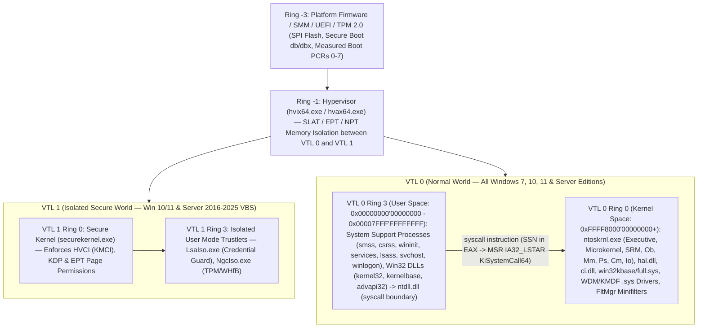
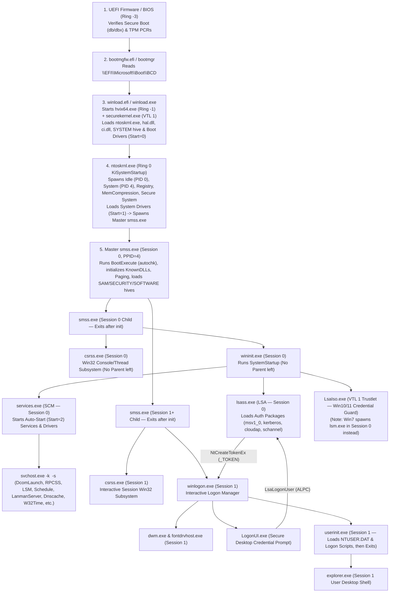
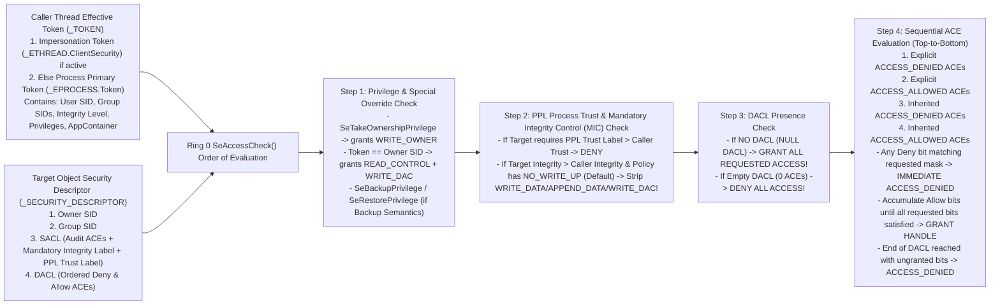

# Windows 7, 10, 11 & Server (2008 R2–2025) Kernel-Space, User-Space, Boot, Authentication & Permissions Strategy Playbook (`windows_kernel_and_userspace_enumeration_strategy_playbook`)

> **Strategy Domain:** `WINDOWS_INTERNALS` (Full-Stack OS Architecture, Ring `-3` $\to$ Ring `3` Enumeration, Boot-to-Shell Lineage, Authentication & Access Control)  
> **Target OS Coverage:** `Windows 7 / Server 2008 R2 (NT 6.1)` $\cdot$ `Windows 10 / Server 2016–2022 (NT 10.0)` $\cdot$ `Windows 11 / Windows Server 2025 (NT 10.0 Build 22000–26100+)`  
> **Primary H-MDP Tactics:** `Passive_Enum` (Ring `-3`/`-1`/`0`/`3` Architecture Baseline) $\to$ `Enumeration` (Process Lineage, Driver/Minifilter & Auth State) $\to$ `Defense_Evasion_Firewall` / `Credential_Access` (Token, DACL/SDDL & Privilege Verification)  
> **Companion Command Playbook:** [[commands/windows_kernel_and_userspace_enumeration_playbook]]  
> **Backlinks:** [[00_MEMORY_INDEX]] | [[knowledge/01_windows_system_process_and_sysinternals]] | [[knowledge/02_windows_registry_boot_and_persistence]] | [[knowledge/03_windows_security_acls_auditing_and_logs]] | [[knowledge/04_windows_powershell_wmi_cim_and_active_directory]] | [[reasoning/windows_digital_forensics_strategy_playbook]]

---

## 1. When Engines & LLM Must Activate This Playbook
Activate `[[reasoning/windows_kernel_and_userspace_enumeration_strategy_playbook]]` and `[[commands/windows_kernel_and_userspace_enumeration_playbook]]` whenever the query or operational goal involves:
- **Privilege Rings & Kernel/User Boundary (`Ring -3` to `Ring 3`):** Analyzing Firmware/UEFI (`Ring -3`), Hyper-V / Virtualization-Based Security (`VBS` / `VTL 1` / `Ring -1`), Kernel Space (`Ring 0`: `ntoskrnl.exe`, `hal.dll`, `ci.dll`, `.sys` drivers, `FltMgr.sys` minifilters, `win32k*.sys`), or User Space (`Ring 3`: `ntdll.dll` syscalls, Win32 subsystem DLLs, PEB/TEB, WOW64).
- **System Process Kickoff & Boot Lineage:** Tracing how Windows boots from UEFI/BIOS $\to$ `bootmgfw.efi`/`bootmgr` $\to$ `winload.efi`/`winload.exe` $\to$ `ntoskrnl.exe` (`System` PID 4) $\to$ `smss.exe` $\to$ `csrss.exe` + `wininit.exe` (Session 0) & `winlogon.exe` (Session 1+) $\to$ `services.exe` + `lsass.exe` + `LsaIso.exe` $\to$ `svchost.exe` $\to$ `userinit.exe` $\to$ `explorer.exe`.
- **Windows Authentication Internals:** Auditing local `SAM`, `NTLMv1`/`NTLMv2`, `Kerberos v5` (`AS-REQ`/`AS-REP`/`TGT`/`PAC`/`TGS-REQ`/`TGS-REP`, Server 2025 `dMSA` & `LKDC`), `CloudAP` (Entra ID / PRT), `WDigest`, `DPAPI`, `Credential Guard` (`LsaIso.exe`), or `UAC` split-token elevation (`AppInfo` / `consent.exe`).
- **Access Control & Securable Object Permissions:** Evaluating how the Ring 0 **Security Reference Monitor (`SRM` / `SeAccessCheck`)** enforces access using `_TOKEN` (Primary vs. Impersonation), `SIDs`, **Mandatory Integrity Control (`MIC`)**, **DACLs / SACLs / ACE inheritance**, **SDDL strings**, and **Token Privileges** (`SeDebugPrivilege`, `SeImpersonatePrivilege`, `SeBackupPrivilege`, `SeRestorePrivilege`, `SeTakeOwnershipPrivilege`, `SeLoadDriverPrivilege`, `SeTcbPrivilege`).
- **Cross-Generation OS Differences:** Distinguishing **Windows 7 / Server 2008 R2** vs. **Windows 10 / Server 2016–2022** vs. **Windows 11 / Windows Server 2025** kernel mitigations, process structures, and security defaults.

---

## 2. Hardware Privilege Rings & Virtual Trust Levels (`Ring -3` to `Ring 3`)



| Privilege Level | CPU Mode / Virtual Trust Level | Address Space & Components | Core OS Security Function | Enumeration Target & Key Artifacts |
| :--- | :--- | :--- | :--- | :--- |
| **Ring -3** | **SMM / UEFI Firmware / TPM 2.0** | SPI Flash, System Management RAM (`SMRAM`), UEFI Runtime Services, TPM 2.0 NVRAM & PCR banks. | Verifies bootloader cryptographic signatures via **UEFI Secure Boot** (`PK`, `KEK`, `db`, `dbx`) and records **Measured Boot** hashes into TPM PCRs `0–7`. | `Confirm-SecureBootUEFI`, `Get-SecureBootUEFI dbx`, `Get-Tpm`, `tbs.dll` log in `C:\Windows\Logs\MeasuredBoot\`. |
| **Ring -1** | **Hypervisor (`Hyper-V` VMX Root)** | `hvix64.exe` (Intel VT-x + EPT) or `hvax64.exe` (AMD-V + RVI/NPT). | Partition manager enforcing **Second-Level Address Translation (`SLAT`)** so `VTL 0` Ring 0 kernel code **cannot** read or modify `VTL 1` memory pages even after a Ring 0 exploit. | `bcdedit /enum {current}` (`hypervisorlaunchtype`), `Get-CimInstance Win32_DeviceGuard`. |
| **VTL 1 Ring 0** | **Secure Kernel (`VBS`)** *(Win10/11 & Server 2016–2025)* | `C:\Windows\System32\securekernel.exe` | Enforces **HVCI** (Hypervisor-Protected Code Integrity — prevents unsigned RWX pages in Ring 0) and **KDP** (Kernel Data Protection — marks driver/kernel config read-only in EPT). | `Win32_DeviceGuard.SecurityServicesRunning` (`1`=Credential Guard, `2`=HVCI), `Secure System` process (`PID` child of `System`). |
| **VTL 1 Ring 3** | **Isolated User Mode (`IUM` Trustlets)** *(Win10/11 & Server 2016–2025)* | `LsaIso.exe` (Credential Guard), `NgcIso.exe` (Windows Hello), `Vmsp.exe`. | Stores NTLM hashes, Kerberos TGT session keys, and MasterKeys in `VTL 1` isolated RAM so `lsass.exe` memory dumps in `VTL 0` only yield encrypted `LsaIso` blobs. | `tasklist /fi "imagename eq LsaIso.exe"`, `HKLM\SYSTEM\CurrentControlSet\Control\Lsa\LsaCfgFlags`. |
| **VTL 0 Ring 0** | **Kernel Space (`CPL=0` Supervisor Mode)** | Upper canonical virtual space (`0xFFFF8000'00000000` – `0xFFFFFFFF'FFFFFFFF` on x64): `ntoskrnl.exe`, `hal.dll`, `ci.dll`, `win32k*.sys`, `.sys` drivers. | Executes thread scheduling (`IRQLs`), memory management (`Mm`), Object Manager (`Ob`), Process Manager (`Ps`), Registry (`Cm`), I/O & Minifilters (`Io`/`FltMgr`), and **Security Reference Monitor (`SRM`)**. | `driverquery /v`, `fltmc`, `sc query type= driver`, `\Device` & `\Driver` Object Manager directories, ETW-Ti, Kernel Callbacks. |
| **Ring 1 & Ring 2** | *(Unused by Windows)* | Legacy x86 descriptor rings (`CPL=1,2`). | Unused on x86/x64 Windows; hardware paging only distinguishes Supervisor (`U/S=0`, Rings 0–2) vs. User (`U/S=1`, Ring 3). | N/A (Replaced by `VTL 0` / `VTL 1` under VBS). |
| **VTL 0 Ring 3** | **User Space (`CPL=3` User Mode)** | Lower canonical virtual space (`0x00000000'00000000` – `0x00007FFF'FFFFFFFF` on x64): System processes, Services, User apps, Subsystem DLLs, `ntdll.dll`. | Executes all applications and user-mode OS services (`smss`, `csrss`, `wininit`, `services`, `lsass`, `svchost`, `winlogon`). Cannot touch hardware or kernel memory directly; must invoke `syscall` via `ntdll.dll`. | `Get-CimInstance Win32_Process`, `tasklist /v /svc`, `whoami /all`, `listdlls`, `handle`, `accesschk`. |

---

## 3. Windows 7 vs. Windows 10 vs. Windows 11 & Server (2008 R2–2025) Architecture Evolution Matrix

| Subsystem / Feature | Windows 7 / Server 2008 R2 (`NT 6.1`) | Windows 10 / Server 2016–2022 (`NT 10.0`) | Windows 11 (`22H2–24H2`) & Windows Server 2025 (`Build 26100+`) |
| :--- | :--- | :--- | :--- |
| **Kernel Version & HAL** | `NT 6.1` (`Build 7600/7601`); separate `hal.dll` (`halacpi.dll`, `halmacpi.dll`). | `NT 10.0` (`Build 14393–20348`); `hal.dll` merged directly into `ntoskrnl.exe` (stub `hal.dll` exports forwarders). | `NT 10.0` (`Build 22000–26100+`); native Rust components in Win32k/GDI (`win32kbase_rs.sys`), SHA-3 kernel crypto, `Hotpatching` support. |
| **Virtualization-Based Security (`VBS` / `VTL 1`)** | **Not Present** (Only Ring 0 and Ring 3 exist). | Introduced **VBS (`VTL 0` / `VTL 1`)**, `securekernel.exe`, **HVCI**, **Credential Guard** (`LsaIso.exe`), **KDP**. Opt-in on early builds; enabled on enterprise hardware. | **Enabled by Default** on compliant hardware (TPM 2.0 + Secure Boot + IOMMU); includes **VBS Enclaves**, **CET Hardware Shadow Stacks**, and **Vulnerable Driver Blocklist** on by default. |
| **System Kernel Processes** | `Idle (0)`, `System (4)` only. | Added `Registry` process (maps hive pages in pageable process space), `Memory Compression` process, and `Secure System` (when VBS is active). | `Idle (0)`, `System (4)`, `Registry`, `Memory Compression`, `Secure System`, `LsaIso.exe` (VTL 1). |
| **Protected Processes (`PP` / `PPL`)** | Single binary `ProtectedProcess` bit in `_EPROCESS` (for DRM media processes only); `lsass.exe` **cannot** run as PPL natively. | Introduced **Protected Process Light (`PPL`)** (`_PS_PROTECTION` with `Signer`: `WinTcb`, `WinSystem`, `Lsa`, `Antimalware` and `Type`: `ProtectedLight` / `Protected`). `RunAsPPL=1` protects `lsass.exe`. | `RunAsPPL` enabled by default on clean Windows 11 (`22H2+`) and Windows Server 2025; blocks `SeDebugPrivilege` handle access (`PROCESS_VM_READ`) from non-PPL user-mode processes. |
| **Session & Service Architecture (`lsm.exe` & `svchost.exe`)** | `lsm.exe` (Local Session Manager) runs as a standalone Session 0 process spawned by `wininit.exe`. Services share grouped `svchost.exe` processes (`netsvcs`, `LocalSystemNetworkRestricted`). | `lsm.exe` refactored into a service DLL (`lsm.dll`) inside `svchost.exe -k DcomLaunch`. On hosts with `>= 3.5 GB` RAM (`Win10 1703+`), most services run in **individual isolated `svchost.exe` PIDs**. | Isolated per-service `svchost.exe` processes by default; `fontdrvhost.exe` (UMFD) isolates font parsing in an AppContainer sandbox instead of Ring 0. |
| **Win32k Graphics Subsystem** | Monolithic `win32k.sys` in Ring 0 (including font parsing). | Split into `win32k.sys` (stub), `win32kbase.sys`, `win32kfull.sys`; font parsing moved to user-mode `fontdrvhost.exe` (`AppContainer`). Win32k syscall filtering (`ProcessSystemCallDisablePolicy`). | Portions of `win32kbase` rewritten in memory-safe **Rust** (`win32kbase_rs.sys`) to eliminate Ring 0 use-after-free/type-confusion EoP. |
| **SAM & Credential Storage (`WDigest` / `SAM` Encryption)** | `WDigest` stores **cleartext passwords** in `lsass.exe` RAM by default! `SAM` hashes encrypted with legacy **RC4** (`SysKey`). | `WDigest` cleartext caching **disabled by default** (unless `UseLogonCredential=1` is set). `SAM` hashes upgraded to **AES-128** (`Revision 2` from Win10 1607+). | `WDigest` disabled; `Credential Guard` (`LsaIso.exe`) + `RunAsPPL` active by default; **Local KDC (`LKDC`)**, **dMSA** (Delegated Managed Service Accounts), and **NTLM reduction/blocking** in Server 2025. |
| **Kernel Exploit Mitigations** | `PatchGuard` (x64), `DEP`, basic `ASLR`, Driver Signature Enforcement (`DSE`). Low-page (`0x00000000`) allocation allowed (`NULL` dereference exploitable!). | `NULL` page allocation blocked (`Win8+`); **SMEP** / **SMAP**; **KASLR**; **CFG** (Control Flow Guard); **KVAS** (Meltdown shadow page tables); `_EPROCESS` handle table pointer obfuscation; Win10 `RS3+` blocks reading physical memory `\Device\PhysicalMemory` from user mode. | **Intel CET / AMD Shadow Stacks (`Kernel-mode Hardware-enforced Stack Protection`)**, **XFG** (Extended Flow Guard), **HVCI**, **KDP**, and mandatory **Microsoft Vulnerable Driver Blocklist**. |

---

## 4. Deep Breakdown of Ring 0 (Kernel Space) vs. Ring 3 (User Space)

### 4.1 Ring 0 (`VTL 0` Kernel Space: `0xFFFF8000'00000000` – `0xFFFFFFFF'FFFFFFFF`)
1. **`ntoskrnl.exe` — The Windows Executive & Microkernel**:
   - **Microkernel Layer (`Ke`)**: Manages CPU control structures (`_KPCR` Processor Control Region at `GS:[0]` in Ring 0, `_KPRCB` Processor Control Block), thread scheduling across 32 priority levels (`0` Zero Page, `1–15` Dynamic, `16–31` Real-Time), Interrupt Request Levels (**IRQLs**: `0 = PASSIVE_LEVEL`, `1 = APC_LEVEL`, `2 = DISPATCH_LEVEL` where page faults are fatal `IRQL_NOT_LESS_OR_EQUAL`, `3–26 = DIRQL`, `31 = HIGH_LEVEL`), and the **System Service Dispatch Table (`SSDT` / `KeServiceDescriptorTable`)** which maps syscall numbers (`SSN`) to `Nt*` kernel functions.
   - **Object Manager (`Ob`)**: Every kernel resource (Process, Thread, File, Registry Key, Section, Token, Mutant/Mutex, Event, SymbolicLink, Device, Driver) is allocated as an Executive Object preceded by an `_OBJECT_HEADER` (containing the reference count, handle count, Object Type index, and pointer to the `_SECURITY_DESCRIPTOR`). User-mode processes never hold raw kernel pointers; they hold 32-bit **Handles** indexed into the process's private kernel `_HANDLE_TABLE` (stored in `_EPROCESS.ObjectTable`), where each entry stores the kernel object address **plus the `GrantedAccess` bitmask** computed at `NtOpen*`/`NtCreate*` time!
   - **Process & Thread Manager (`Ps`)**: Tracks every process via an **`_EPROCESS`** structure in Non-Paged Pool (`UniqueProcessId`, `InheritedFromUniqueProcessId` PPID, `ActiveProcessLinks` doubly-linked list, `Token` `_EX_FAST_REF` pointer where the lowest 4 bits store the reference count on x64, `Protection` `_PS_PROTECTION` byte for PP/PPL, `Peb` pointer to user-space `_PEB`, `ImageFileName`). Tracks every thread via **`_ETHREAD`** (`Cid.UniqueProcess`, `Cid.UniqueThread`, `Tcb` `_KTHREAD`, `ClientSecurity` impersonation token pointer).
   - **Security Reference Monitor (`SRM` / `Se`)**: The single kernel component (`SeAccessCheck`, `SeSinglePrivilegeCheck`) that compares a thread's Effective `_TOKEN` against an object's `_SECURITY_DESCRIPTOR` whenever a handle is opened. Once a handle is granted with `GrantedAccess`, subsequent reads/writes using that handle do **not** re-run `SeAccessCheck`!
   - **Memory Manager (`Mm`)**: Manages 4-level (48-bit, 256 TB) or 5-level (`LA57` 57-bit, 128 PB on Server 2022/2025) page tables, per-process **VAD (Virtual Address Descriptor) AVL trees** (`_EPROCESS.VadRoot`) tracking committed/reserved memory regions and protections (`PAGE_READONLY`, `PAGE_READWRITE`, `PAGE_EXECUTE_READ`, `PAGE_EXECUTE_READWRITE`), and Kernel Pools (`NonPagedPoolNx`, `PagedPool`).
   - **Configuration Manager (`Cm`)**: Implements the Registry in Ring 0 (`\REGISTRY\MACHINE`, `\REGISTRY\USER`) backed by Hive files on disk (`C:\Windows\System32\config\{SYSTEM,SAM,SECURITY,SOFTWARE}`, `\Boot\BCD`, `NTUSER.DAT`) mapped into the **`Registry` process** (Win10/11) or Paged Pool (Win7).
   - **I/O Manager (`Io`) & Filter Manager (`FltMgr.sys`)**: Packages all file, device, and network operations into **IRPs (`_IRP`)** dispatched down layered `_DEVICE_OBJECT` stacks to `_DRIVER_OBJECT` major function handlers (`MajorFunction[IRP_MJ_CREATE]`, `IRP_MJ_READ`, `IRP_MJ_WRITE`, `IRP_MJ_DEVICE_CONTROL`). File system Minifilters register with `FltMgr.sys` at deterministic **Altitudes** (`360000–389999` Activity Monitor like Sysmon/Procmon; `320000–329999` Antivirus/EDR; `140000` Encryption/BitLocker).
   - **Kernel Telemetry & Security Callbacks (EDR / Defender Hooks in Ring 0)**: Since `PatchGuard` (`Kernel Patch Protection`) forbids modifying the SSDT or patching `ntoskrnl.exe` code on x64, security drivers and rootkits operate via official Ring 0 callback arrays:
     - `PspCreateProcessNotifyRoutine` (`PsSetCreateProcessNotifyRoutineEx`)
     - `PspCreateThreadNotifyRoutine` (`PsSetCreateThreadNotifyRoutine`)
     - `PspLoadImageNotifyRoutine` (`PsSetLoadImageNotifyRoutine`)
     - `CallbackListHead` on `_OBJECT_TYPE` (`ObRegisterCallbacks` — strips `PROCESS_VM_READ`/`PROCESS_VM_WRITE` from handles to protected processes)
     - `CallbackListHead` in Configuration Manager (`CmRegisterCallbackEx` — intercepts Registry operations)
     - **ETW Threat Intelligence (`EtwTi` — `Microsoft-Windows-Threat-Intelligence`)**: Emits kernel-level events for `NtAllocateVirtualMemory`, `NtProtectVirtualMemory`, `NtMapViewOfSection`, and remote thread injection directly from `ntoskrnl.exe` to PPL-protected security consumers.

### 4.2 Ring 3 (`VTL 0` User Space: `0x00000000'00000000` – `0x00007FFF'FFFFFFFF`) & The Syscall Transition
1. **Per-Process User-Space Data Structures**:
   - **`_PEB` (Process Environment Block)**: Resides in user space (`GS:[0x60]` on x64, `FS:[0x30]` on x86); contains `BeingDebugged`, `ImageBaseAddress`, `Ldr` (`_PEB_LDR_DATA` with `InLoadOrderModuleList`, `InMemoryOrderModuleList`, `InInitializationOrderModuleList` doubly-linked lists of loaded DLLs), and `ProcessParameters` (`_RTL_USER_PROCESS_PARAMETERS` holding `ImagePathName`, `CommandLine`, `CurrentDirectory`, and `Environment`).
   - **`_TEB` (Thread Environment Block)**: Resides in user space (`GS:[0x30]` on x64, `FS:[0x18]` on x86); contains thread stack limits (`StackBase`, `StackLimit`), `LastErrorValue` (`GetLastError()`), `ThreadLocalStoragePointer`, and pointer to the `_PEB`.
2. **The User-to-Kernel Syscall Pipeline**:
   - **Step 1 (Application / Win32 API)**: Process calls documented Win32 API (e.g., `kernel32!OpenProcess` or `advapi32!OpenProcessToken`).
   - **Step 2 (`KernelBase.dll` / `Sechost.dll`)**: Validates parameters and forwards to the Native API in `ntdll.dll` (`ntdll!NtOpenProcess` / `ntdll!ZwOpenProcess`).
   - **Step 3 (`ntdll.dll` Syscall Stub)**:
     ```nasm
     mov r10, rcx              ; Save 1st argument (RCX is clobbered by syscall instruction)
     mov eax, <SSN>            ; Load System Service Number (e.g. 0x26 for NtOpenProcess on Win10/11)
     test byte ptr [7FFE0308h], 1 ; Check KUSER_SHARED_DATA.SystemCall flag
     jne short int2e
     syscall                   ; Transition CPU from Ring 3 (CPL=3) to Ring 0 (CPL=0)
     ret
     ```
     *(Note: `KUSER_SHARED_DATA` is mapped read-only at fixed virtual address `0x7FFE0000` in every user-mode process and read-write at `0xFFFFF780'00000000` in Ring 0, providing system time, OS build number, and processor features without a syscall!)*
   - **Step 4 (`ntoskrnl!KiSystemCall64` in Ring 0)**: CPU reads target RIP from MSR `IA32_LSTAR` (`0xC0000082`), switches `CS`/`SS` to Ring 0 selectors, swaps `GS` base via `swapgs` to point to the kernel `_KPCR`, switches to the thread's Kernel Stack (`_KTHREAD.InitialStack`), looks up index `EAX` (`SSN`) in `KeServiceDescriptorTable` (`SSDT`) (or `KeServiceDescriptorTableShadow` if bit 12 `0x1000` is set for `win32k` GUI syscalls), sets `PreviousMode = UserMode (1)` in `_KTHREAD`, and invokes the Ring 0 `Nt*` implementation!
   - *(Note on `Nt*` vs `Zw*`: In Ring 3 `ntdll.dll`, `NtOpenFile` and `ZwOpenFile` point to the exact same address and always set `PreviousMode = UserMode`. In Ring 0 `ntoskrnl.exe`, calling `NtOpenFile` preserves the caller's `PreviousMode`, whereas calling `ZwOpenFile` re-enters via `KiServiceInternal`, setting `PreviousMode = KernelMode (0)` so kernel pointer validation and `SeAccessCheck` are bypassed for trusted kernel callers!)*

---

## 5. Complete Chronological System Process Kickoff (`Boot` $\to$ `Kernel` $\to$ `Logon` $\to$ `User Shell`)



### Canonical Process Lineage Validation Table (Essential for Anomaly & Rootkit Hunting)
| Process Name | Expected Image Path | Expected Parent (`PPID`) | Expected Session ID | Expected Account / Integrity | Expected Instance Count & Notes |
| :--- | :--- | :--- | :--- | :--- | :--- |
| **`System Idle Process`** | *(Kernel internal)* | None (`PID 0`) | `0` | `NT AUTHORITY\SYSTEM` (`Kernel`) | Exactly `1` (`PID 0`). |
| **`System`** | `ntoskrnl.exe` *(Kernel)* | `PID 0` (`PID 4`) | `0` | `NT AUTHORITY\SYSTEM` (`System`) | Exactly `1` (`PID 4`). Hosts all kernel-mode worker threads (`PsCreateSystemThread`). |
| **`Registry`** / **`MemCompression`** / **`Secure System`** | *(Minimal/Pico Kernel Processes — Win10/11)* | `System (PID 4)` | `0` | `NT AUTHORITY\SYSTEM` (`System`) | `0` on Win7; `1` each on Win10/11 & Server 2016–2025 (`Secure System` present when VBS is enabled). |
| **`smss.exe`** | `C:\Windows\System32\smss.exe` | `System (PID 4)` | `0` (Master) | `NT AUTHORITY\SYSTEM` (`System`) | `1` persistent master instance (`Session 0`). Child `smss.exe` instances exit immediately after spawning `csrss.exe` + `wininit.exe`/`winlogon.exe`. |
| **`csrss.exe`** | `C:\Windows\System32\csrss.exe` | *(Child `smss.exe` — already exited!)* | `0` and `1+` | `NT AUTHORITY\SYSTEM` (`System` / `PPL-WinTcb`) | `1` in Session `0` + `1` per active interactive/RDP session (`Session 1, 2...`). **Never** spawned by `explorer.exe` or `cmd.exe`! |
| **`wininit.exe`** | `C:\Windows\System32\wininit.exe` | *(Session 0 `smss.exe` — already exited!)* | `0` | `NT AUTHORITY\SYSTEM` (`System` / `PPL-WinTcb`) | Exactly `1` in `Session 0`. Any second `wininit.exe` or `Session > 0` is malicious! |
| **`services.exe`** | `C:\Windows\System32\services.exe` | `wininit.exe` | `0` | `NT AUTHORITY\SYSTEM` (`System` / `PPL-WinTcb`) | Exactly `1` in `Session 0`. Parent of all `svchost.exe` and service binaries. |
| **`lsass.exe`** | `C:\Windows\System32\lsass.exe` | `wininit.exe` | `0` | `NT AUTHORITY\SYSTEM` (`System` / `PPL-Lsa`) | **Exactly `1` in `Session 0`**. Multiple `lsass.exe` processes or wrong parent (`!= wininit.exe`) is a critical IOC! |
| **`LsaIso.exe`** | `C:\Windows\System32\LsaIso.exe` | `wininit.exe` | `0` | `NT AUTHORITY\SYSTEM` (`VTL 1 Trustlet`) | `0` or `1` in `Session 0` (present when Credential Guard is active on Win10/11/Server). |
| **`lsm.exe`** *(Win7 only)* | `C:\Windows\System32\lsm.exe` | `wininit.exe` | `0` | `NT AUTHORITY\SYSTEM` (`System`) | `1` on **Windows 7 / Server 2008 R2 only**; on Win10/11 `lsm.dll` runs inside `svchost.exe -k DcomLaunch`. |
| **`svchost.exe`** | `C:\Windows\System32\svchost.exe` | `services.exe` | `0` *(or user session for per-user services `_*`)* | `SYSTEM`, `LOCAL SERVICE`, `NETWORK SERVICE`, or logged-on user | **Must always have `services.exe` as parent** and `-k <Group>` in command line! |
| **`winlogon.exe`** | `C:\Windows\System32\winlogon.exe` | *(Session 1+ `smss.exe` — already exited!)* | `1+` | `NT AUTHORITY\SYSTEM` (`System`) | `1` per interactive/RDP session (`Session 1, 2...`). |
| **`explorer.exe`** | `C:\Windows\explorer.exe` | *(Spawned by `userinit.exe`, which exits!)* | `1+` | Logged-on User (`Medium` Integrity) | `1+` per interactive session; parent `userinit.exe` has normally exited. |

---

## 6. End-to-End Windows Authentication Process & Credential Architecture

### 6.1 Step-by-Step Interactive & Network Authentication Flow
1. **Credential Collection (`Winlogon` / `LogonUI` / `SSPI`)**:
   - **Interactive Logon (`Logon Type 2` Console, `Type 10` RDP, `Type 7` Unlock, `Type 11` CachedInteractive)**: User presses `Ctrl+Alt+Del`Secure Attention Sequence (`SAS`) intercepted by `winlogon.exe`, which switches to the isolated `WinSta0\Winlogon` desktop and launches `LogonUI.exe`. Hardware/software **Credential Providers** (`HKEY_LOCAL_MACHINE\SOFTWARE\Microsoft\Windows\CurrentVersion\Authentication\Credential Providers`) serialize credentials into a buffer.
   - **Network Logon (`Logon Type 3` SMB/RPC/WinRM/HTTP, `Type 8` NetworkCleartext, `Type 9` NewCredentials / `runas /netonly`)**: Server service (`srv2.sys` / `LanmanServer` / `HTTP.sys`) receives an `SPNEGO` (`1.3.6.1.5.5.2`) token and invokes `AcceptSecurityContext` via `sspicli.dll` / `secur32.dll`.
2. **LSA Dispatch (`LsaLookupAuthenticationPackage` & `LsaLogonUser`)**:
   - Request crosses ALPC port `\LsaAuthenticationPort` into **`lsass.exe`** (`lsasrv.dll`), which creates a new **Logon Session** identified by a globally unique 64-bit **`LUID` (Locally Unique Identifier)** (`999 / 0x3e7` = `SYSTEM`, `997 / 0x3e5` = `LOCAL SERVICE`, `996 / 0x3e4` = `NETWORK SERVICE`) and dispatches to the selected **Authentication Package (`AP`) / Security Support Provider (`SSP`)**:
     - **`MSV1_0.DLL` (Local SAM & Domain NTLMv1/v2)**:
       - **Local Account**: Queries `HKLM\SAM\Domains\Account\Users\<RID>\V`, decrypts the stored 16-byte `NT Hash` (`MD4(UTF-16LE(password))`) using the `BootKey` (derived from `JD`, `Skew1`, `GBG`, `Data` class names under `HKLM\SYSTEM\CurrentControlSet\Control\Lsa` via AES-128 on Win10 1607+/11 or RC4 on Win7), and compares hashes. If Domain-joined and DC is unreachable, verifies against **MSCASH2 / Domain Cached Credentials (`DCC2`)** (`PBKDF2-HMAC-SHA1`, 10,240 iterations) in `HKLM\SECURITY\Cache` (`NL$1`–`NL$10`).
       - **Domain NTLMv2**: Sends 8-byte Server Challenge + Client Blob + User/Domain to a Domain Controller over the Netlogon Secure Channel (`NetrLogonSamLogonEx` RPC).
     - **`KERBEROS.DLL` (Active Directory Kerberos v5)**:
       - **Step A (`AS-REQ` / `AS-REP`)**: Encrypts current UTC timestamp with user's long-term key (AES-256-CTS-HMAC-SHA1-96 `etype 18` or RC4-HMAC `etype 23`). KDC (`kdcsvc.dll` on DC) validates against `NTDS.dit` and returns a **TGT** (encrypted with `krbtgt` key) containing the signed **PAC (Privilege Attribute Certificate)** (User SID, Domain Group RIDs, Universal Groups, Resource Groups).
       - **Step B (`TGS-REQ` / `TGS-REP`)**: `kerberos.dll` requests a Service Ticket for the local computer's SPN (`HOST/<computername>$`) so `lsass.exe` can decrypt the Service Ticket with the machine account's AD password hash (stored in `HKLM\SECURITY\Policy\Secrets\$MACHINE.ACC`) and extract the verified **PAC**!
       - **Step C (PAC Signature Verification)**: `lsass.exe` verifies both the KDC signature (`ServerSignature` + `KdcSignature`) on the PAC to prevent Silver Ticket PAC forgery.
     - **`CLOUDAP.DLL` & `NGC` (Entra ID / Azure AD & Windows Hello for Business — Win10/11)**:
       - Authenticates against Entra ID / TPM-bound asymmetric keys (`NgcIso.exe` in `VTL 1`), issuing a **Primary Refresh Token (`PRT`)** and constructing a cloud-to-on-prem Kerberos TGT (`Kerberos Cloud Trust`) when accessing hybrid AD resources.
3. **Local Group Expansion & UAC Split-Token Filtering (`lsasrv.dll`)**:
   - `lsass.exe` takes the verified User SID and Domain Group SIDs (from SAM or Kerberos PAC) and queries the local `SAM` database (`HKLM\SAM\Domains\Builtin\Aliases`) to append any local groups (`S-1-5-32-544` `BUILTIN\Administrators`, `S-1-5-32-545` `BUILTIN\Users`, `S-1-5-32-555` `Remote Desktop Users`) that contain the user or their domain groups.
   - `lsass.exe` queries the **Local Security Policy (`HKLM\SECURITY\Policy\Accounts\<SID>\Privilgs`)** to look up every User Right (`SeInteractiveLogonRight`, `SeNetworkLogonRight`, `SeDeny*LogonRight`) and Privilege (`SeDebugPrivilege`, `SeImpersonatePrivilege`, etc.) granted to any SID in the user's token.
   - **UAC Admin Approval Mode Check**: If the token contains `BUILTIN\Administrators` (`S-1-5-32-544`) or elevated privileges on an interactive logon (`Type 2`/`10`/`11`), `lsass.exe` calls `NtCreateTokenEx` **twice**:
     - **Full Elevated Token**: `High` Integrity (`S-1-16-12288`), `Administrators` SID marked `Enabled`, all admin privileges (`SeDebugPrivilege`, `SeBackupPrivilege`, etc.) present (Initially `Disabled` until `AdjustTokenPrivileges` enables them).
     - **Filtered Standard Token**: `Medium` Integrity (`S-1-16-8192`), `Administrators` SID changed to **`USE_FOR_DENY_ONLY`**, and all administrative privileges stripped (leaving only `SeChangeNotifyPrivilege`, `SeShutdownPrivilege`, `SeUndockPrivilege`, `SeIncreaseWorkingSetPrivilege`, `SeTimeZonePrivilege`).
     - Both tokens point to each other via `TokenLinkedToken` in Ring 0 (`_TOKEN`). The user's desktop (`explorer.exe`) receives the **Filtered `Medium` Token**.

---

## 7. How Windows Access & Permissions Operate (Ring 0 Security Reference Monitor `SRM`)



### 7.1 Securable Objects & Where Their Security Descriptors Live
Every object managed by the Ring 0 Object Manager (`Ob`) or protected by a user-mode server (`SCM`, `WMI`, `Active Directory`) has a `_SECURITY_DESCRIPTOR`:
1. **Files & Directories (`NTFS`)**: Stored in the `$SECURITY_DESCRIPTOR` (`0x50`) attribute / `$Secure` metadata file on the NTFS volume (`icacls`, `Get-Acl`).
2. **Registry Keys (`Cm`)**: Stored in `_CM_KEY_SECURITY` cells inside the Registry Hive (`Get-Acl HKLM:\...`, `regini`, `subinacl`).
3. **Windows Services (`SCM` inside `services.exe`)**: Stored in the `Security` value under `HKLM\SYSTEM\CurrentControlSet\Services\<ServiceName>\Security` (`sc sdshow <ServiceName>`, `accesschk -ucqv <ServiceName>`).
4. **Kernel Processes & Threads (`_EPROCESS`, `_ETHREAD`)**: Stored in the Ring 0 `_OBJECT_HEADER` in Non-Paged Pool (`accesschk -p <PID>`).
5. **Named Pipes (`\Device\NamedPipe\`), Sections (`\BaseNamedObjects\`), Events, Mutants & Symbolic Links**: Stored in the Ring 0 `_OBJECT_HEADER` (`accesschk -o`, `\\.\pipe\`).
6. **Active Directory Objects (`NTDS.dit`)**: Stored in the `nTSecurityDescriptor` attribute (`Get-Acl "AD:\DC=..."`, `dsacls`).

### 7.2 High-Impact Token Privileges That Bypass DACLs in Ring 0
| Privilege Name | Ring 0 Bypass Behavior | Operational & Escalation Impact |
| :--- | :--- | :--- |
| **`SeDebugPrivilege`** | In `PsOpenProcess` / `PsOpenThread`, grants `PROCESS_ALL_ACCESS` / `THREAD_ALL_ACCESS` **without consulting the target process's DACL** (blocked only by `PPL` `_PS_PROTECTION` or `VTL 1` Secure Kernel). | Allows reading `lsass.exe` memory (if not PPL/VBS) or injecting into `SYSTEM` processes (`winlogon.exe`, `services.exe`) to become `NT AUTHORITY\SYSTEM`. |
| **`SeImpersonatePrivilege`** / **`SeAssignPrimaryTokenPrivilege`** | Allows a thread to attach an Impersonation Token (`SecurityImpersonation` / `SecurityDelegation`) or assign a Primary Token to a new child process (`CreateProcessWithTokenW` / `CreateProcessAsUserW`). | **Service Account (`LOCAL SERVICE` / `NETWORK SERVICE` / `IIS AppPool` / `MSSQL`) $\to$ `SYSTEM` Escalation** via Named Pipe / RPC / DCOM coercion (`PrintSpoofer`, `GodPotato`, `Efspotato`). |
| **`SeBackupPrivilege`** | In `IopCreateFile` (`ntfs.sys`), when `FILE_OPEN_FOR_BACKUP_INTENT` is passed, grants `GENERIC_READ` / `READ_CONTROL` **bypassing the file/registry DACL completely**. | Allows reading any locked or ACL-restricted file on disk (`NTDS.dit`, `SAM`, `SYSTEM`, `SECURITY` hives via `reg save` or `DiskShadow`). |
| **`SeRestorePrivilege`** | When `FILE_OPEN_FOR_BACKUP_INTENT` is passed, grants `GENERIC_WRITE`, `DELETE`, `WRITE_DAC`, and `WRITE_OWNER` **bypassing the file/registry DACL completely**. | Allows overwriting any `System32` DLL/service binary or modifying any Registry service `ImagePath` for instant `SYSTEM` execution. |
| **`SeTakeOwnershipPrivilege`** | Grants `WRITE_OWNER` access right on any securable object during `SeAccessCheck`, even if the DACL explicitly denies the caller. | Caller runs `takeown /f <target>`, becomes the **Owner**, and then uses the Owner's implicit `WRITE_DAC` right (`icacls <target> /grant ...`) to grant themselves Full Control! |
| **`SeLoadDriverPrivilege`** | Permits calling `NtLoadDriver(HKLM\System\CurrentControlSet\Services\<Driver>)` to load a signed `.sys` driver into **Ring 0**. | Enables loading a legitimate signed driver (or vulnerable signed driver — BYOVD) into Ring 0 without being an Administrator if the user can write to a driver key under `HKCU` or `HKLM`. |
| **`SeTcbPrivilege`** | *"Act as part of the operating system"* — trusted by `lsass.exe` to call `LsaLogonUser` and mint arbitrary security tokens with any SIDs/groups. | Direct `NT AUTHORITY\SYSTEM` equivalent. |

### 7.3 SDDL (Security Descriptor Definition Language) Fast-Decode Reference for Engines & LLM
Format: `O:<OwnerSID>G:<GroupSID>D:<DACL_Flags>(ACE1)(ACE2)...S:<SACL_Flags>(ACE1)...`  
Each `(ACE)` has 6 semicolon-separated fields: `(AceType;AceFlags;Rights;ObjectGuid;InheritObjectGuid;AccountSid)`
- **AceType**: `A` = Allow (`ACCESS_ALLOWED`), `D` = Deny (`ACCESS_DENIED`), `AU` = Audit, `ML` = Mandatory Integrity Label (`S:(ML;;NW;;;HI)` = High Integrity, `NW` = No Write Up).
- **AceFlags**: `OI` = Object Inherit (files), `CI` = Container Inherit (subfolders), `IO` = Inherit Only, `NP` = No Propagate, `ID` = Inherited.
- **Rights (Generic / File / Service)**: `GA` = Generic All (`FullControl`), `GW` = Generic Write, `GR` = Generic Read, `GX` = Generic Execute, `FA` = File All, `FW` = File Write, `FR` = File Read, `FX` = File Execute, `SD` = Delete, `WD` = Write DAC (`ChangePermissions`), `WO` = Write Owner (`TakeOwnership`), `CC` = Service Query Config, `DC` = **Service Change Config (`SERVICE_CHANGE_CONFIG` — allows changing `binPath`!)**, `RP` = **Service Start (`SERVICE_START`)**, `WP` = **Service Stop (`SERVICE_STOP`)**.
- **AccountSid Short Codes**: `SY` = `NT AUTHORITY\SYSTEM` (`S-1-5-18`), `BA` = `BUILTIN\Administrators` (`S-1-5-32-544`), `BU` = `BUILTIN\Users` (`S-1-5-32-545`), `WD` = `Everyone` (`S-1-1-0`), `AU` = `Authenticated Users` (`S-1-5-11`), `IU` = `Interactive Users` (`S-1-5-4`), `NS` = `NETWORK SERVICE` (`S-1-5-20`), `LS` = `LOCAL SERVICE` (`S-1-5-19`), `AN` = `Anonymous` (`S-1-5-7`), `LW` = `Low Integrity` (`S-1-16-4096`), `ME` = `Medium Integrity` (`S-1-16-8192`), `HI` = `High Integrity` (`S-1-16-12288`), `SI` = `System Integrity` (`S-1-16-16384`).

---

## 8. Full-Stack OS Enumeration Strategy (Ring `-3` $\to$ Ring `-1` $\to$ Ring `0` $\to$ Ring `3`)

Execute full Windows OS enumeration in **6 deterministic architectural layers** (see [[commands/windows_kernel_and_userspace_enumeration_playbook]] for copy-paste one-liners):

1. **Layer 1 — OS Build, Hardware Ring `-3` (UEFI/Secure Boot/TPM) & Ring `-1` (`VBS`/`VTL 1`/`HVCI`/`Credential Guard`) Baseline**:
   - Identify exact NT kernel build (`Win7 7601` vs `Win10 19045` vs `Win11 26100` vs `Server 2016/2019/2022/2025`), UEFI vs Legacy BIOS, Secure Boot state, TPM 2.0 readiness, `bcdedit` boot configuration (`nx`, `testsigning`, `nointegritychecks`, `hypervisorlaunchtype`), and `Win32_DeviceGuard` VBS/HVCI/Credential Guard status.
2. **Layer 2 — Ring `0` Kernel Space, Loaded `.sys` Drivers, `FltMgr` Minifilters, Kernel Mitigations & Object Manager Namespace**:
   - Enumerate all loaded kernel drivers (`driverquery /v`, `Get-CimInstance Win32_SystemDriver`), verify Authenticode signatures on `.sys` files (`sigcheck64 -accepteula -e -u -vr C:\Windows\System32\drivers`), enumerate all active file-system Minifilter drivers and Altitudes (`fltmc filters`, `fltmc instances`), inspect system-wide Ring 0/Ring 3 exploit mitigations (`Get-ProcessMitigation -System`), and inspect the Ring 0 Object Manager namespace (`\GLOBAL??`, `\Device`, `\Driver`, `\KernelObjects`, `\BaseNamedObjects`, `\\.\pipe\`).
3. **Layer 3 — Boot-to-Shell Process Lineage (`System` $\to$ `smss` $\to$ `csrss`/`wininit`/`winlogon` $\to$ `services`/`lsass`/`svchost` $\to$ `explorer`), PPL & Loaded Modules**:
   - Reconstruct the complete parent-child process tree (`PID`, `PPID`, `SessionId`, `CreationDate`, `ExecutablePath`, `CommandLine`), validate against the **Canonical Process Lineage Table (Section 5)**, inspect Protected Process / PPL levels (`RunAsPPL`, `Protection`), and audit loaded user-space DLLs (`ntdll.dll`, `KnownDLLs`, unsigned DLLs via `listdlls64 -u`).
4. **Layer 4 — Authentication Subsystem (`LSASS`, `SAM`, `NTLM`, `Kerberos`, `CloudAP`, `DPAPI`, `Vault`) Enumeration**:
   - Enumerate active Logon Sessions (`klist sessions`, `Win32_LogonSession`, `LogonId` LUIDs), cached Kerberos tickets (`klist`), stored Windows Credentials & Web/Windows Vault items (`cmdkey /list`, `vaultcmd /list`), LSA authentication/notification/security packages (`HKLM\SYSTEM\CurrentControlSet\Control\Lsa`), `WDigest` setting, NTLM restriction level (`LmCompatibilityLevel`), and Active Directory / Domain Controller trust state (`nltest /dsgetdc:`, `gpresult /r`).
5. **Layer 5 — Access Control, Security Tokens (`_TOKEN`), UAC Split-Token & Privilege Enumeration**:
   - Enumerate the current process/thread token (`whoami /all`), Integrity Level (`Low`/`Medium`/`High`/`System`), UAC configuration (`EnableLUA`, `ConsentPromptBehaviorAdmin`, `FilterAdministratorToken`, `LocalAccountTokenFilterPolicy`), and all Local Users, Local Groups (`net localgroup Administrators`), and Domain Group memberships.
6. **Layer 6 — Securable Object Permission (`DACL` / `SACL` / `SDDL`) Audit across Files, Services, Registry, Scheduled Tasks & Named Pipes**:
   - Audit Windows Service SDDLs (`sc sdshow`, `accesschk -ucqv *`) for `WD`/`BU`/`AU`/`IU` holding `DC` (`SERVICE_CHANGE_CONFIG`), `WD` (`WRITE_DAC`), or `WO` (`WRITE_OWNER`).
   - Audit Service Binary paths & Unquoted Service Paths (`icacls` on binary and parent directories).
   - Audit Registry Autorun/Service keys (`HKLM\SYSTEM\CurrentControlSet\Services\*`, `HKLM\SOFTWARE\Microsoft\Windows\CurrentVersion\Run`) for non-admin write access.
   - Audit Named Pipes (`\\.\pipe\*`) and Scheduled Tasks (`schtasks /query /fo LIST /v`) for weak DACLs or `SYSTEM` impersonation vectors.
