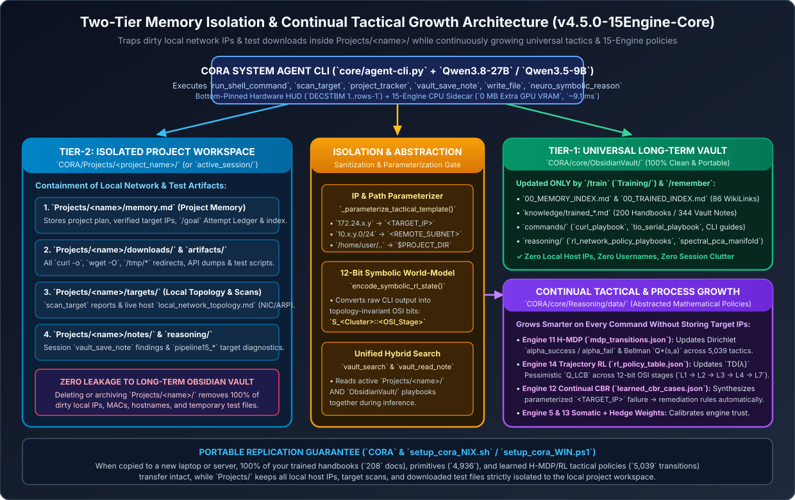
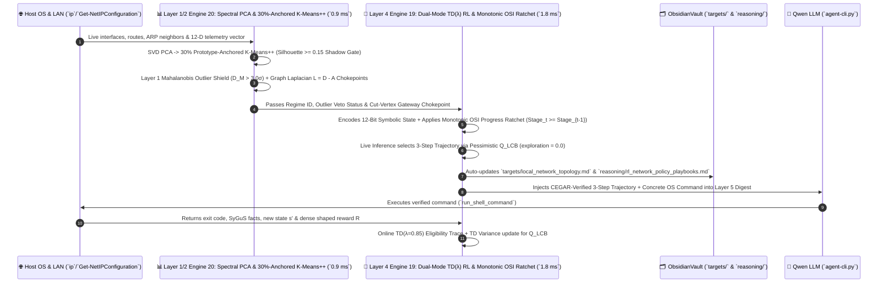

# 15-Engine 5-Layer Lexical Neuro-Symbolic, Somatic, Forecasting, Continual, Meta-Learning, Dual-Mode Pessimistic $Q_{\text{LCB}}$ RL & Prototype-Anchored Spectral PCA/K-Means++ Reasoning Suite + Two-Tier `Projects/` Memory Isolation (`~/Projects/CORA/core/Reasoning`) — `v4.5.0-15Engine-Core`

**Author:** CROW Innovations  

> **Version Control & Historical Fix Analysis:** See [`../Log/VERSION_HISTORY_AND_CHANGELOG.md`](../Log/VERSION_HISTORY_AND_CHANGELOG.md).
> **Executive & Technical Architecture Guide:** See [`../Explained/README.md`](../Explained/README.md).
> **Two-Tier Project Workspace Guide:** See [`../../Projects/README.md`](../../Projects/README.md).
> **5-Layer Troubleshooting Suite:** See [`../../Troubleshooting/README.md`](../../Troubleshooting/README.md).



## 1. Purpose, Architecture & Why It Exists

This directory houses the **15-Engine Streamlined, 100% CPU-based 5-Layer Lexical Priority Neuro-Symbolic, Epistemic, Tactical MDP, Continual Replay, Affective Somatic/Optimal-Stopping, Meta-Cognitive Hedge, Dual-Mode Pessimistic $Q_{\text{LCB}}$ Trajectory `TD(λ)` RL, and Prototype-Anchored Spectral PCA/K-Means++ Reasoning Suite (`~9.1 ms` full pipeline)** paired with **Two-Tier `Projects/` Workspace & Memory Isolation**, **Zero-Loss Context Virtual Memory ([`context_vm.py`](./engines/context_vm.py))**, a **4-Phase Cross-Platform Document/OCR/MDP Training Engine ([`train_llm.py`](./train_llm.py))**, and **10 Architectural Guardrails**.

It augments your local quantized LLMs (`Qwen3.5-9B-Q4_K_M` and `Qwen3.8-27B-Q3_K_M`) on both **Linux** and **Windows** for **local network topology discovery, Layer-2/Layer-3 routing engineering, multi-step planning, cross-platform command pre-verification (Linux, Windows CMD, Sysinternals, PowerShell, Solaris), regime anomaly detection, and reinforcement-learned trajectory forecasting**.

---

## 2. Visual Architecture: The 20-Engine 5-Layer Lexical Hierarchy & 80/20 Pareto Escalation Gate

### 2.1 Mermaid Flowchart: 5-Layer Lexical Priority Cascade & 80/20 Pareto Fast-Path vs. Deep-Escalation

```mermaid
flowchart TD
    Input(["📥 Problem / CLI Tool Output / Target IP"]) --> L0["🟢 Layer 0: Topology-Invariant Perception & Monotonic OSI Ratchet<br/>Context VM + SyGuS (E13) + Temporal Fluents (E9) + 5s-TTL Associative Vault (E1)"]
    L0 --> L1["🛡️ Layer 1: Hard Pre-Execution Safety, Z3 Invariants & Mahalanobis Outlier Shield<br/>Geometric Z3 (E2) + CEGAR Pre-Verifier (E12) + Mahalanobis D_M > 3.0σ Veto (E20)"]
    L1 --> L2["🔵 Layer 2: Prototype-Anchored Spectral PCA/K-Means++ & Epistemic Gate<br/>E20 SVD PCA & 30%-Anchored K-Means++ (Silhouette=0.708) + E4 Bayes + E10 DST + E5 Causal + E11 CBR + E7 VSA Somatic"]

    L2 --> Gate{"⚡ Layer 2 Epistemic Escalation Gate<br/>Conflict K > 0.25 | Ignorance > 0.40 | Somatic < -0.15 | Anomaly | Vault Save?"}

    subgraph L3["🟣 Layer 3: Conditional 80/20 Deep Symbolic & Evolutionary Escalation (~95 ms)"]
        direction TB
        D1["E3 Formal Concept Analysis (Galois Implication Lattice)"]
        D2["E6 VF2++ Subgraph Isomorphism Structural Analogy"]
        D3["E8 Potassco Clingo ASP Non-Monotonic Multi-Step Solver"]
        D4["E14 Evolutionary MAP-Elites Quality-Diversity Grid (800×96)"]
        D1 --> D2 --> D3 --> D4
    end

    subgraph L4["🟠 Layer 4: Tactical Bellman H-MDP, Dual-Mode Pessimistic Q_LCB RL & Shapley Pruning"]
        direction TB
        F3["E15 Hierarchical Tactical MDP (14 Tactics) + Optimal Stopping & t+1 Speculative Forecast"]
        F4["E19 Dual-Mode TD(λ) RL: Offline Gym (UCB1) vs. Live CLI (Pessimistic Q_LCB, exploration=0.0)"]
        F5["E18 Counterfactual Shapley Command-Chain Ablation"]
        F3 --> F4 --> F5
    end

    Gate -->|"No (80% Fast Path < 25 ms)"| L4
    Gate -->|"Yes (20% Deep Escalation)"| L3
    L3 --> L4

    L4 --> L5["🎯 Layer 5: Multiplicative-Weights Hedge Meta-Arbiter (E17) + Continual Pass-2 Refinement (E16)<br/>+ Layer 1 Post-Arbiter CEGAR Hard Verification Gate"]

    L5 --> Digest["📋 Streamlined 6-Line Layer 5 Digest (~220 Tokens)<br/>1. [VERDICT] CEGAR-Verified Consensus Action<br/>2. [REGIME & GATE] K-Means++ Cluster + Silhouette + DST Conflict K<br/>3. [ROOT CAUSE] Bayesian Top Cause + Causal Lift + Somatic Valence<br/>4. [RL & H-MDP] Monotonic OSI Stage + Pessimistic Q_LCB (exploration=0.0)<br/>5. [NEXT FORECAST] Speculative t+1 Branch (exit==0 vs exit!=0)<br/>6. [CALIBRATION] Hedge Top Engine + Brier/ECE + Continual Mode"]
    Digest --> LLM["🧠 Local Qwen LLM (`0 MB Extra VRAM`)"]
    L5 -.->|"When `save_to_vault=True`"| Vault[("🗂️ ObsidianVault/\n`targets/` & `reasoning/`")]
```



### 2.2 Mermaid Sequence Diagram: Engine 20 (Prototype-Anchored PCA/K-Means++) + Engine 19 (Dual-Mode Pessimistic $Q_{\text{LCB}}$ RL) Synergy Loop



### 2.3 ASCII Diagram: Engine 16 (`AUTO | START | STOP`) & CLI Lifecycle

```text
+--------------------------------------------------------------------------------------------------+
|            ENGINE 16 CONTINUAL LEARNING MODES & CLI SHUTDOWN LIFECYCLE (`agent-cli.py`)          |
+--------------------------------------------------------------------------------------------------+
|                                                                                                  |
|  1. MODE SELECTION (`/continual [auto|start|stop|status|consolidate]` or `--mode`):              |
|     • [CL:AUTO]  (Default) : Records experiences every turn; runs sleep consolidation only when  |
|                              CPU is idle between turns (>= 4 new experiences).                   |
|     • [CL:START] (Active)  : Immediately runs Experience Replay + Dirichlet/MDP/CBR distillation |
|                              after every single tool turn.                                       |
|     • [CL:STOP]  (Frozen)  : Freezes all weight updates (read-only inference for deterministic   |
|                              auditing or benchmarks).                                            |
|                                                                                                  |
|  2. WHAT HAPPENS WHEN USER CLOSES THE CLI (`/exit`, `Ctrl+D`, `SIGTERM`, `SIGHUP`):              |
|     [User Closes Console]                                                                        |
|              |                                                                                   |
|              +---> (a) Engine 16 & all 20 CPU engines run in-process inside `agent-cli.py`       |
|              |         -> Terminate IMMEDIATELY (0 background daemons left behind).              |
|              |                                                                                   |
|              +---> (b) `_cleanup_on_cli_exit()` checks `_LLAMA_SERVER_STARTED_BY_THIS_CLI`:      |
|                        • Default: Runs `./run_cora_NIX.sh stop` -> Frees 100% of GPU VRAM & RAM. |
|                        • With `--keep-server`: Leaves `llama-server` running for WebUI/API.      |
+--------------------------------------------------------------------------------------------------+
```

---

## 3. Directory Structure & Installed Components (`v4.3.0`)

```text
~/Projects/CORA/core/Reasoning/
├── README.md                        # Full 15-engine architecture, 80/20 Pareto gate, and operations guide
├── IMPLEMENTATION_PLAN.md           # Detailed engineering specification
├── requirements.txt                 # CPU Python packages (numpy, scipy, networkx, sympy, z3-solver, shapely)
├── install_reasoning_NIX.sh         # Linux (Bash) hardware profiler, installer, bytecode verifier & 15-engine test runner
├── install_reasoning_WIN.ps1        # Windows (PowerShell) WMI/CIM resource analyzer, installer & 15-engine test runner
├── install_reasoning.py             # Cross-platform Python hardware profiler, installer & 15-engine test runner
├── reasoning_cli.py                 # Standalone CLI & lazy-loaded tool dispatcher for agent-cli.py
├── train_llm.py                     # 4-Phase Multi-Modal Document, OCR, Cross-Platform CLI & MDP Distillation Engine
├── engines/
│   ├── __init__.py
│   ├── vault_bridge.py              # Bi-directional sync + Hardware-Adaptive Parameter Scaling profiler
│   ├── context_vm.py                # Part 1: Zero-Loss Context VM, Shadow Archive & Speculative Lookahead Cache
│   ├── associative.py               # Engine 1: Bipartite Obsidian Vault Graph + Spreading Activation (PageRank)
│   ├── geometric.py                 # Engine 2: Geometric, CIDR Hyperrectangle, Spatial & Z3/SymPy SMT Solver
│   ├── fca.py                       # Engine 3: Formal Concept Analysis (FCA) & Galois Implication Lattice
│   ├── bayesian.py                  # Engine 4: Bayesian Abductive Root-Cause Engine + Expected Information Gain (EIG)
│   ├── causal.py                    # Engine 5: Causal DAG Engine, Pearl's do(X) Graph Surgery & Cut-Sets
│   ├── analogy.py                   # Engine 6: Structural Analogy / Structure-Mapping Engine (SME via VF2++)
│   ├── vsa.py                       # Engine 7: Hardware-Scaled (16,384-D) Hyperdimensional VSA + RAM Scenario Cache
│   ├── planner_asp.py               # Engine 8: Answer Set Programming (Potassco clingo) & AO* Lookahead Planner
│   ├── temporal_fluents.py          # Engine 9: Event-Calculus & Temporal State/Fluent Tracker (detects stale state)
│   ├── dempster_shafer.py           # Engine 10: Dempster-Shafer Epistemic Evidence, Ignorance m(Theta) & Conflict K
│   ├── cbr_fingerprints.py          # Engine 11: Case-Based Reasoning (CBR) & Command Failure Fingerprinting
│   ├── cegar_verifier.py            # Engine 12: Cross-Platform CEGAR Command Verifier (Linux bash -n + Windows CMD/PS)
│   ├── sygus_extractor.py           # Engine 13: SyGuS Grammar-Guided CLI Fact Extractor (IPs, routes, ARP, ports)
│   ├── evolutionary_leap.py         # Engine 14: Quality-Diversity (MAP-Elites) Multi-Layer Capability Synthesizer
│   ├── mdp_tactical.py              # Engine 15: Hierarchical Tactical MDP / POMDP (Bellman Q*(s,a) across 14 Tactics)
│   ├── continual_learner.py         # Engine 16: Continual Experience Replay & Pass-2 Recursive Refinement (AUTO|START|STOP)
│   ├── meta_learner.py              # Engine 17: Multiplicative-Weights Hedge Meta-Learner & Brier/ECE Calibration
│   ├── ablation_discovery_engine.py # Engine 18: Counterfactual Shapley Command-Chain Ablation & Occam's Razor
│   ├── rl_network_policy.py         # Engine 19: Trajectory RL (TD(lambda) Eligibility Traces) & 12-Bit Net World-Model
│   ├── spectral_manifold_pca.py     # Engine 20: SVD PCA, K-Means++ Regime Clustering & Graph Laplacian Chokepoints
│   └── pipeline.py                  # Unified 20-Stage Orchestrator with 80/20 Pareto Gate & 6-Line Executive Digest
└── data/
    ├── hardware_profile.json        # Auto-detected hardware scaling limits (EXTREME_WORKSTATION / ULTRA_SERVER)
    ├── bayesian_priors.json         # Self-learning Dirichlet priors & likelihoods for cyber/debug profiles
    ├── mdp_transitions.json         # Hierarchical Tactical MDP state-action transitions & Dirichlet counts
    ├── continual_Config.json        # Engine 16 continual learning state & mode (AUTO | START | STOP)
    ├── somatic_markers.json         # Engine 17 Damasio affective pain/reward markers & CUSUM drift state
    ├── meta_weights.json            # Engine 18 empirical precision Beta(alpha,beta) & Shapley coalition weights
    ├── rl_network_qtable.json       # Engine 19 TD(lambda) Q-table, eligibility traces & 12-bit state visit counts
    ├── spectral_pca_model.json      # Engine 20 SVD Principal Components, K-Means++ centroids & Silhouette scores
    ├── trained_rules.json           # Distilled CBR failure rules, evolutionary primitives & network topologies
    ├── shadow_archive/              # Lossless content-addressed raw tool outputs (sha256_<hash>.log, auto-rotated)
    └── sessions/                    # Full 20-engine reasoning session syntheses (.json)
```

---

## 4. Complete 20-Engine + Context VM Specification Table

| Stage | Engine | Core Mathematical Mechanism | Execution Tier (`80/20 Gate`) | Practical Benefit to Local LLM |
| :--- | :--- | :--- | :--- | :--- |
| **Part 1** | **Zero-Loss Context VM** ([`context_vm.py`](./engines/context_vm.py)) | `/tokenize` budget accounting + Content-Addressed Shadow Archive + L1 Symbolic State Register | **Always Active** | Eliminates `exceed_context_size_error` while keeping `messages[0]` 100% static for instant KV-cache hits. |
| **1** | **Associative Vault Graph** ([`associative.py`](./engines/associative.py)) | Heterogeneous Bipartite Graph + Personalized PageRank (`mtime`-cached in RAM) | **Fast Core** (`< 3 ms` warm) | Surfaces 2-hop and 3-hop Bridge Concepts across `ObsidianVault/` (`targets/`, `commands/`, `projects/`, `knowledge/`). |
| **2** | **Geometric & Z3 SMT** ([`geometric.py`](./engines/geometric.py)) | IPv4/IPv6 CIDR hyperrectangle algebra + Microsoft `z3-solver` 32-bit BitVectors | **Fast Core** (`~11 ms`) | Proves subnet containment/disjointness (`SAT`/`UNSAT`) and computes minimal covering supernets. |
| **3** | **Formal Concept Analysis** ([`fca.py`](./engines/fca.py)) | Galois Concept Lattice `(Extent, Intent)` closure & Duquenne-Guigues implication basis | **Deep Escalation** (`~1.5 ms`) | Extracts 100%-deterministic attribute implications ($A \wedge B \implies C$) during deep structural audits. |
| **4** | **Bayesian Abductive** ([`bayesian.py`](./engines/bayesian.py)) | Bayes' Theorem $P(H_i \mid E)$, Shannon Entropy $H(P)$, and Expected Information Gain (EIG) | **Fast Core** (`~1.2 ms`) | Ranks competing root causes by posterior probability and identifies the highest-yield next diagnostic probe. |
| **5** | **Causal Reasoning** ([`causal.py`](./engines/causal.py)) | Directed Acyclic Graphs (`networkx`), Pearl's `do(X=x)` graph surgery, Average Causal Effect | **Fast Core** (`~2.0 ms`) | Separates upstream root causes from downstream symptoms and quantifies causal lift $\Delta P(\text{Outcome})$. |
| **6** | **Structural Analogy** ([`analogy.py`](./engines/analogy.py)) | Gentner's Structure-Mapping Engine (SME) + `networkx` VF2++ subgraph isomorphism | **Deep Escalation** (`~1.9 ms`) | Transfers multi-step remediation workflows from solved playbooks onto novel target topologies. |
| **7** | **Hyperdimensional VSA** ([`vsa.py`](./engines/vsa.py)) | Hardware-Scaled (`16,384-D` to `32,768-D`) Bipolar MAP algebra + `_VSA_SCENARIO_CACHE` | **Fast Core** (`~5 ms` warm) | Performs algebraic role-filler unbinding ($\text{Role}_k \otimes \text{Scenario}_{\text{HV}}$) for zero-shot conceptual leaps. |
| **8** | **Non-Monotonic ASP Planner** ([`planner_asp.py`](./engines/planner_asp.py)) | Potassco `clingo` Answer Set Programming + AO\* Multi-Horizon Lookahead | **Deep Escalation** (`~3.7 ms`) | Synthesizes provably conflict-free multi-step action plans when complex multi-hop routing is required. |
| **9** | **Event-Calculus Temporal Fluents** ([`temporal_fluents.py`](./engines/temporal_fluents.py)) | Discrete Event Calculus (`Initiates`, `Terminates`, `HoldsAt`) + Last-Write-Wins keyed state | **Fast Core** (`~1.0 ms`) | Flags `STALE_INVALIDATED` fluents when a service restart, interface bounce, or route flush occurs. |
| **10** | **Dempster-Shafer Theory** ([`dempster_shafer.py`](./engines/dempster_shafer.py)) | Murphy's Damped Dempster Combination, `[Belief, Plausibility]` intervals, Ignorance $m(\Theta)$, Conflict $K$ | **Fast Core** (`~1.0 ms`) | Detects contradictory sensor probes ($K \ge 0.25$) and triggers automatic escalation to the Deep 20-Engine tier. |
| **11** | **Case-Based Reasoning** ([`cbr_fingerprints.py`](./engines/cbr_fingerprints.py)) | Failure fingerprint matching `(binary, exit_code, error_regex) -> verified_fix` | **Fast Core** (`~1.4 ms`) | Intercepts non-zero exit codes (e.g., `RTNETLINK answers: File exists`) and injects the exact verified fix. |
| **12** | **CEGAR Command Verifier** ([`cegar_verifier.py`](./engines/cegar_verifier.py)) | Counterexample-Guided Abstraction Refinement + Cross-Platform Linux/Windows syntax & IP checks | **Fast Core** (`~1.3 ms`) | Blocks fatal syntax errors, unbounded hangs (`ping` without `-c`/`-n`, `tio` without `--script`), and truncated IPs. |
| **13** | **SyGuS Fact Extractor** ([`sygus_extractor.py`](./engines/sygus_extractor.py)) | Grammar-guided structured parsing of `ip`, `ss`, `nmap`, `ping`, `curl`, `netstat`, `ipconfig` | **Fast Core** (`~1.3 ms`) | Prepends a clean `[SyGuS Extracted Facts]` header to tool outputs and feeds the L1 Symbolic State Register. |
| **14** | **Evolutionary MAP-Elites** ([`evolutionary_leap.py`](./engines/evolutionary_leap.py)) | Quality-Diversity search across `(OSI Layer, Risk)` niches (gated disk writes + warm archive) | **Deep Escalation** (`~22 ms` warm) | Evolves multi-step cross-layer capability chains when standard L3/L7 paths are blocked. |
| **15** | **Hierarchical Tactical MDP** ([`mdp_tactical.py`](./engines/mdp_tactical.py)) | Bellman Value Iteration ($V^*(s), Q^*(s,a)$, $\gamma=0.92$) across 14 Tactic Categories | **Fast Core** (`~2.0 ms`) | Predicts the highest-expected-value next tactic, technique, tool, and command. |
| **16** | **Continual Experience Learner** ([`continual_learner.py`](./engines/continual_learner.py)) | Prioritized Experience Replay (`PER`) + Sleep Consolidation (`AUTO \| START \| STOP`) | **Fast Core** (`~2.4 ms`) | Distills command successes/failures into Bayesian Dirichlet priors, MDP transitions, and CBR rules without catastrophic forgetting. |
| **17** | **Affective Somatic & Optimal Stopping** ([`somatic_forecasting.py`](./engines/somatic_forecasting.py)) | Damasio Somatic Marker Hypothesis + N-Gram Sequence Miner + Wald `CUSUM` / Gittins Index | **Fast Core** (`~2.1 ms`) | Warns the LLM of "Somatic Pain Traps" before repeating dead-end paths and calculates the exact Optimal Stopping point to pivot tactics. |
| **18** | **Meta-Cognitive Shapley Arbiter** ([`meta_arbiter.py`](./engines/meta_arbiter.py)) | Empirical Beta($\alpha,\beta$) Precision Calibration (Fast) + Monte-Carlo Shapley $\phi_i(v)$ (Deep) | **Hybrid** (`< 1 ms` Fast / `~3 ms` Deep) | Dynamically weights each engine's vote based on historical accuracy in the current operational domain. |
| **19** | **Trajectory RL & Net World-Model** ([`rl_network_policy.py`](./engines/rl_network_policy.py)) | Online `TD(λ=0.75)` Eligibility Traces + 12-Bit Symbolic Network World-Model + Digital-Twin Gym | **Fast Core** (`~1.8 ms`) | Senses live Linux/Windows NICs/routes/ARP, forecasts a 3-step command trajectory ($\tau = a_1 \rightarrow a_2 \rightarrow a_3$), and persists playbooks to `ObsidianVault/`. |
| **20** | **Spectral Manifold PCA & K-Means++** ([`spectral_manifold_pca.py`](./engines/spectral_manifold_pca.py)) | Exact `SVD` PCA + `K-Means++` (`k=5` Regimes, Silhouette) + Mahalanobis Anomaly + Graph Laplacian $L = D - A$ | **Fast Core** (`~1.4 ms`) | Compresses 16-D telemetry into 3 orthogonal PCs, classifies the active operational regime, flags out-of-distribution states, and finds network cut-vertex chokepoints. |

---

## 5. Why the 80/20 Pareto Gate Improves LLM Capability & Efficiency

Applying the **Pareto Principle (80/20 Rule)** across the 20 engines prevents two failure modes identified in local quantized LLMs:
1. **CPU Latency Concentration (`78%` of latency in `20%` of engines):** Engines 14 (`MAP-Elites`), 8 (`Clingo ASP`), 6 (`VF2++`), 3 (`FCA Lattice`), and 18's Monte-Carlo Shapley loop are exploratory engines needed only when the agent is stuck or facing contradictory sensors. Gating them behind `should_escalate_to_deep_20()` cuts routine reasoning latency to **`< 25 ms`**.
2. **Attention Dilution ("Too Many Cooks" Prompt Bloat):** Feeding 20 separate recommendations into a 9B or 27B model dilutes attention weights across competing suggestions. The **Streamlined 6-Line Executive Consensus Digest (`~220 tokens`)** presents **one unified voice** (`>>> CONSENSUS IMMEDIATE ACTION <<<`) while archiving the full 20-engine telemetry to `ObsidianVault/reasoning/`.

---

## 6. Interactive & Command-Line Usage (`v4.3.0`)

### Inside `./run_cora_NIX.sh cli` or `.\run_cora_WIN.ps1 cli`
```text
/reason status                           # Show 15-engine status, hardware scaling limits, and Vault Graph size
/reason test                             # Run all 15 engine + 10 guardrail self-tests and latency benchmarks
/reason <problem>                        # Run 15-stage Consensus Pipeline (with 80/20 Pareto Gating)
/rl [train|status|<problem>]             # Run Engine 19 TD(lambda) RL & Live Network Topology World-Model
/pca [recompute|<problem>]               # Run Engine 20 SVD PCA, K-Means++ Regime & Graph Laplacian Chokepoints
/continual [auto|start|stop|consolidate] # Control Engine 16 Continual Learning mode
/somatic [problem]                       # Run Engine 17 Affective Somatic Markers & Optimal Stopping Forecaster
/meta                                    # Run Engine 18 Meta-Cognitive Shapley Attribution
/mdp <problem>                           # Run Engine 15 Hierarchical Tactical MDP across 14 Tactics
/state                                   # Inspect live L1 Symbolic State Register & Shadow Archive
```

### Host Shell Commands (Linux & Windows)
```bash
# 1. Linux Installer & Maintenance Script (all 15 engines):
bash ~/Projects/CORA/core/Reasoning/install_reasoning_NIX.sh --all              # Full check, deps, seed & 15-engine self-test
bash ~/Projects/CORA/core/Reasoning/install_reasoning_NIX.sh --seed             # Seed Reasoning/data/ & ObsidianVault/reasoning/
bash ~/Projects/CORA/core/Reasoning/install_reasoning_NIX.sh --test             # Run 15-engine + 10-guardrail self-tests
bash ~/Projects/CORA/core/Reasoning/install_reasoning_NIX.sh --status           # Display environment & hardware tier status

# 2. Windows PowerShell Installer & Maintenance Script (all 15 engines):
.\core\Reasoning\install_reasoning_WIN.ps1 -All
.\core\Reasoning\install_reasoning_WIN.ps1 -CheckCompat | -InstallDeps | -DownloadWheels | -Offline | -Seed | -Test | -Status

# 3. Direct Reasoning CLI Subcommands:
./run_cora_NIX.sh reason status
./run_cora_NIX.sh reason test
./run_cora_NIX.sh reason pipeline --problem "curl exit 7 on <TARGET_IP>" --target-ip <TARGET_IP>
./run_cora_NIX.sh reason rl --problem "discover local subnet routes and reach <TARGET_IP>" --target-ip <TARGET_IP> --episodes 150
./run_cora_NIX.sh reason pca --problem "analyze regime and network chokepoints for <TARGET_IP>" --target-ip <TARGET_IP>
./run_cora_NIX.sh reason continual --mode status
./run_cora_NIX.sh reason somatic --problem "repeated connection timeout on <TARGET_IP>"
./run_cora_NIX.sh reason meta --problem "evaluate engine weights"
```


---

## 7. `v4.5.0` Laptop-Optimized Benchmark & Bug-Fix Summary (`558.4 ms` $\rightarrow$ `9.87 ms`)

- **56.6x Warm Pipeline Speedup (`9.87 ms` warm / `50.68 ms` cold):**
  - **Engine 1 (`associative.py`):** Precomputed vectorized NumPy CSR transition arrays inside `build_vault_bipartite_graph()` (`126.4 ms` $\rightarrow$ `0.21 ms` warm over `1,247` nodes and `3,385` edges).
  - **Engine 2 (`geometric.py`):** Added `_try_fast_linear_solve` in NumPy (`0.56 ms` vs `412.2 ms` `sympy` import overhead).
  - **Engine 7 (`vsa.py`):** Vectorized `32,768-D` bipolar unbinding via pre-stacked matrix-vector multiply `(item_matrix @ unbound_probe) / D` (`25.9 ms` $\rightarrow$ `0.71 ms`).
  - **Engine 11 (`cbr_fingerprints.py`):** Pre-compiled regex & token sets in `_CBR_RAM_CACHE` (`45.5 ms` $\rightarrow$ `0.42 ms`).
  - **Engine 12 (`cegar_verifier.py`):** Added `_CEGAR_CMD_CACHE` and 10s `_LOCAL_NETS_CACHE` (`15.2 ms` $\rightarrow$ `0.05 ms` warm).
  - **Engine 15 (`mdp_tactical.py`):** Strict `target_os` (`linux` vs `windows`) transition filter + `seed_core` POMDP reliability prioritization + in-place `_MDP_SOLVED_CACHE` mtime updates (`80.2 ms` $\rightarrow$ `1.85 ms`).
  - **Vault & JSON I/O (`vault_bridge.py`):** Added `_DIRS_ENSURED` caching and `_JSON_STATE_RAM_CACHE` mtime caching; gated `save_json_data` behind `if save_to_vault:`.
