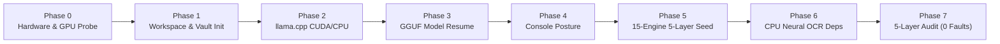
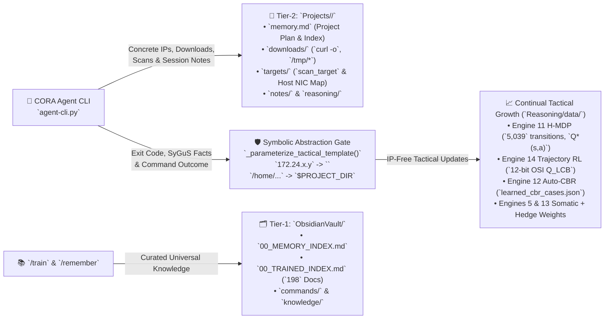

# C.O.R.A. Setup & Operations Reference (`core/SetupHowItWorks.md`) — `v5.14.11` (Linux & Windows)

**Version:** `5.14.11` (tracked in [`Log/cora_version.json`](./Log/cora_version.json))  
**Developed by:** https://CROWinnovations.com  

> **OPEN-SOURCE NOTICE, ATTRIBUTION & LIMITATION OF LIABILITY:**  
> C.O.R.A. is open-source software under active development and continuous refinement. Redistribution, modification, or operational deployment is permitted provided that clear attribution and development credit to https://CROWinnovations.com are retained in all copies and derivative works. C.O.R.A. and its layered reasoning engines are provided `"AS IS"` without warranty of any kind. The developer assumes no liability or legal responsibility for any actions, damages, data loss, or legal consequences arising from the use of this system.


### How C.O.R.A.'s 3-Section Semantic Version (`5.14.11`) Works
Displayed directly above `Author: https://CROWinnovations.com` on the CLI startup splash screen as `Version: 5.14.11` and persisted in [`Log/cora_version.json`](./Log/cora_version.json):
- **1st Decimal (`5` — Major CLI Overhauls):** Increments on major CLI or architectural overhauls (such as the `v5` C.O.R.A. splash screen, root `run_cora_NIX.sh` / `run_cora_WIN.ps1` and `setup_cora_NIX.sh` / `setup_cora_WIN.ps1` launchers, clean `CORA/` root layout, 4-Mode Session Personality & Logic Enforcement (`Default`, `Analyst`, `Berserker`, `Ninja`), mandatory `/Projects` selection/rename/create menu, `-c` session continuation, Red/White/Blue `-netiso` isolation, quoted goals `"..."` + `-<param>:<value>` syntax, and legal disclaimer).
- **2nd Decimal (`14` — Reasoning & Logic Engine Updates):** Automatically increments via SHA-256 file-tree fingerprinting whenever any of the reasoning or logic engines in `core/Reasoning/engines/*.py` are updated or modified.
- **3rd Decimal (`11` — Documentation, Tools & System Retraining):** Automatically increments whenever documentation (`*.md`), CLI/management tools (`agent-cli.py`, `run_cora_NIX.sh`, `run_cora_WIN.ps1`, `report_generator.py`, `train_llm.py`), or system retraining (`/train` / `./run_cora_NIX.sh -train` / `.\run_cora_WIN.ps1 -train`) are updated.

A complete architectural and operational guide describing how **C.O.R.A. (`Cyber Oriented Reasoning Agent`) + Root Launchers (`run_cora_NIX.sh` / `run_cora_WIN.ps1`) + Two-Tier Memory & Project Workspace Isolation (`core/ObsidianVault/` + `Projects/<name>/`) + 15-Engine 5-Layer Lexical Priority CPU Neuro-Symbolic, Somatic, Optimal-Stopping Forecasting, Continual, Meta-Learning, Dual-Mode Pessimistic $Q_{\text{LCB}}$ Trajectory RL & Prototype-Anchored Spectral PCA/K-Means++ Reasoning Suite + Multi-Modal/OCR Training Pipeline (`Training/`)** is installed, configured, tuned, and operated across both **Linux (`./setup_cora_NIX.sh` / `./run_cora_NIX.sh`)** and **Windows (`.\setup_cora_WIN.ps1` / `.\run_cora_WIN.ps1`)** workstations, portable laptops, and GPU servers.

> **Version Control & Historical Fix Analysis:** See [`Log/VERSION_HISTORY_AND_CHANGELOG.md`](./Log/VERSION_HISTORY_AND_CHANGELOG.md).  
> **Multi-Modal & OCR Training Plan:** See [`Explained/TrainingPlan.md`](./Explained/TrainingPlan.md) (`./run_cora_NIX.sh -train` / `.\run_cora_WIN.ps1 -train` / `./Training/train_llm_NIX.sh` / `.\Training\train_llm_WIN.ps1`).  
> **5-Layer Troubleshooting Suite:** See [`../Troubleshooting/README.md`](../Troubleshooting/README.md) (`./run_cora_NIX.sh troubleshoot` / `.\run_cora_WIN.ps1 troubleshoot` / `bash Troubleshooting/troubleshoot_llm_NIX.sh` / `.\Troubleshooting\troubleshoot_llm_WIN.ps1`).

---

## 1. End-to-End Setup Process: How It Works (`setup_cora_NIX.sh` & `setup_cora_WIN.ps1`)



Both the Linux master installer (`setup_cora_NIX.sh`) and the Windows master installer (`setup_cora_WIN.ps1`) execute an identical **7-Phase Automated Deployment Pipeline** that turns a bare machine into a fully verified, hardware-tuned local AI agent workstation:

### Phase 0: Hardware Discovery & Automatic Model Selection
1. **CPU Topology Probing:**
   - **Linux:** Queries `lscpu` and `nproc` to detect physical cores, hybrid Intel P-cores vs. E-cores, and logical threads.
   - **Windows:** Queries CIM `Win32_Processor` and `[Environment]::ProcessorCount` to detect physical cores and logical threads.
2. **System RAM & Disk Probing:**
   - **Linux:** Reads `/proc/meminfo` (`MemTotal`, `MemAvailable`).
   - **Windows:** Queries CIM `Win32_OperatingSystem` (`TotalVisibleMemorySize`, `FreePhysicalMemory`) and Win32 `GlobalMemoryStatusEx`.
3. **NVIDIA GPU & VRAM Probing:**
   - Queries `nvidia-smi --query-gpu=name,memory.total,memory.free --format=csv,noheader,nounits` on both Linux and Windows.
4. **Automatic Model Selection (Hardware-Aware):**
   - Always selects **`Qwen3.5-9B-Uncensored-Q4_K_M.gguf`** (~5.24 GiB / 5.62 GB, fast model).
   - Automatically selects **`Qwen3.8-27B-Uncensored-Q3_K_M.gguf`** (~12.40 GiB / 13.31 GB, default flagship model) whenever total system RAM is **>= 15,000 MiB (~15 GiB)** (or when `--all-models` / `-AllModels` or `--only-3.8` / `-Only38` is passed).
   - Automatically selects **`Qwen3.8-27B-Turbo-MTP-Q4_K_M.gguf`** (~17.23 GiB, Multiple Token Prediction for increased speed) whenever total system RAM is **>= 24,000 MiB (~24 GiB)** or GPU VRAM is **>= 16,000 MiB** (or when `--turbo`, `--only-turbo-q4`, `--all-turbo`, or `--all-models` is passed).
   - Automatically selects **`Qwen3.8-27B-Turbo-MTP-Q6_K.gguf`** (~22.38 GiB, Multiple Token Prediction) whenever total system RAM is **>= 48,000 MiB (~48 GiB)** or GPU VRAM is **>= 24,000 MiB** (or when `--only-turbo-q6`, `--all-turbo`, or `--all-models` is passed).
   - Automatically selects **`Qwen3.8-27B-Turbo-MTP-Q8_0.gguf`** (~28.16 GiB, Multiple Token Prediction) whenever total system RAM is **>= 64,000 MiB (~64 GiB)** or GPU VRAM is **>= 32,000 MiB** (or when `--only-turbo-q8`, `--all-turbo`, or `--all-models` is passed).

### Phase 1: Workspace Architecture, Log Migration & Obsidian Knowledge Vault Initialization
1. Creates all standard workspace directories:
   - `core/bin/` — Local `llama.cpp` inference server (`llama-server` / `llama-server.exe`) and CUDA runtime shared libraries (`.so` / `.dll`).
   - `models/` — Local GGUF quantized model weights (`Qwen3.8-27B-Uncensored-Q3_K_M.gguf` and `Qwen3.5-9B-Uncensored-Q4_K_M.gguf`).
   - `core/Log/` — Centralized service logs (`llama-server.log`), PID/model state files (`llama-server.pid`, `llama-server.model`), and `VERSION_HISTORY_AND_CHANGELOG.md`. Automatically migrates any legacy root-level log/PID files into `core/Log/`.
   - `Projects/` — Isolated per-project workspaces (`Projects/<project_name>/` or `Projects/active_session/`). Stores all downloaded data (`downloads/`), temporary test files (`artifacts/`), target scans (`targets/`), session reasoning notes (`reasoning/`), and the project's `memory.md` so internal/dirty local network knowledge never pollutes `core/ObsidianVault/`.
   - `core/ObsidianVault/` — Long-term universal knowledge graph (`00_MEMORY_INDEX.md`, `00_TRAINED_INDEX.md`, `.obsidian/app.json`, `commands/`, `knowledge/`, `reasoning/`).
   - `core/Reasoning/` — 15-Engine CPU Neuro-Symbolic, Epistemic, Continual, RL, PCA & Tactical MDP Reasoning Suite (`0 MB GPU VRAM`).
   - `Training/` — Drop-in folder for multi-modal training documents (`.md`, `.txt`, `.json`, `.pdf`, `.docx`, `.html`, `.svg`, `.png`, `.jpg`) and network diagrams (`train_llm_NIX.sh` / `train_llm_WIN.ps1`).
   - `core/Network_Isolation/` — Firewall, network namespace, and console security posture detection scripts (`ConsolePostureDetection_NIX.sh` / `ConsolePostureDetection_WIN.ps1`).
   - `Troubleshooting/` — 5-Layer Diagnostic, Fault-Isolation & Auto-Repair Suite (`troubleshoot_llm_NIX.sh` / `troubleshoot_llm_WIN.ps1`).
   - `core/Explained/`, `core/open-webui-data/`.

### Phase 2: `llama.cpp` (`b11802`) CUDA / CPU Binary Download & Verification
1. **Linux (`setup_cora_NIX.sh`):**
   - Checks if `core/bin/llama-server` exists and passes `LD_LIBRARY_PATH=core/bin ./core/bin/llama-server --version`.
   - Downloads official `ggml-org/llama.cpp` release `b11802` (`llama-b11802-bin-ubuntu-x64.tar.gz`) and configures CUDA 12 shared libraries (`libggml-cuda.so`, `libcublas.so.12`, `libcublasLt.so.12`, `libcudart.so.12`) when an NVIDIA GPU is present.
2. **Windows (`setup_cora_WIN.ps1`):**
   - Checks if `core\bin\llama-server.exe` exists and passes `.\core\bin\llama-server.exe --version`.
   - If an NVIDIA GPU is detected via `nvidia-smi`, downloads and extracts both official Windows CUDA 12.4 x64 release archives from `ggml-org/llama.cpp` tag `b11802`:
     - `llama-b11802-bin-win-cuda-12.4-x64.zip` (`llama-server.exe`, `llama-cli.exe`, `ggml-cuda.dll`, `llama.dll`, etc.)
     - `cudart-llama-bin-win-cuda-12.4-x64.zip` (`cublas64_12.dll`, `cublasLt64_12.dll`, `cudart64_12.dll`)
   - Automatically falls back to the Windows CPU x64 archive (`llama-b11802-bin-win-cpu-x64.zip`) if no NVIDIA GPU is present or if CUDA verification fails.
   - Verifies `core\bin\llama-server.exe --version` (`version: 11802`).

### Phase 3: Resumable GGUF LLM Model Downloads & Byte-Size Verification (`models/`)
Both installers (and `./run_cora_NIX.sh download -m <MODEL>` / `.\run_cora_WIN.ps1 download -m <MODEL>`) download the uncensored GGUF models from Hugging Face with **automatic byte-level resume** (`wget -c` / `curl -C -` on Linux; `curl.exe -fL --retry 5 --retry-delay 3 -C -` on Windows) and enforce strict minimum byte-size verification so partial or corrupted downloads are never accepted:

| Model Key & `-m` Abbreviations | Local Filename in `models/` | Source URL | Minimum Verified Size |
| :--- | :--- | :--- | :--- |
| **`qwen3.8` (`-m 3.8` \| `27b` \| `q3`) [DEFAULT]** | `Qwen3.8-27B-Uncensored-Q3_K_M.gguf` | `https://huggingface.co/0bserverx/Qwen3.8-27B-Heretic-Abliterated-Uncensored-GGUF/resolve/main/RVN-Q3_K_M-multilingual.gguf` | `>= 13,000,000,000` bytes (~12.40 GiB / 13.31 GB) |
| **`qwen3.5` (`-m 3.5` \| `9b` \| `fast`) [FAST]** | `Qwen3.5-9B-Uncensored-Q4_K_M.gguf` *(linked to `Qwen3.5-9B-Uncensored-HauhauCS-Aggressive-Q4_K_M.gguf`)* | `https://huggingface.co/HauhauCS/Qwen3.5-9B-Uncensored-HauhauCS-Aggressive/resolve/main/Qwen3.5-9B-Uncensored-HauhauCS-Aggressive-Q4_K_M.gguf` | `>= 5,500,000,000` bytes (~5.24 GiB / 5.62 GB) |
| **`turbo-q4` (`-m turbo` \| `mtp` \| `turbo-q4` \| `3.8-turbo` \| `q4`) [MTP-Q4]** | `Qwen3.8-27B-Turbo-MTP-Q4_K_M.gguf` *(linked to `Qwen3.8-27B-TurboFCFusion-735-882-Here-Uncen-NEO-CODER-MAX-MTP-Q4_K_M.gguf`)* | `https://huggingface.co/DavidAU/Qwen3.8-27B-TURBO-Fable-Cold-Fusion-735-882-Heretic-Uncensored-NEO-CODER-MAX-MTP-GGUF/resolve/main/Qwen3.8-27B-TurboFCFusion-735-882-Here-Uncen-NEO-CODER-MAX-MTP-Q4_K_M.gguf` | `>= 18,000,000,000` bytes (~17.23 GiB / 18.50 GB) |
| **`turbo-q6` (`-m turbo-q6` \| `mtp-q6` \| `3.8-q6` \| `q6`) [MTP-Q6]** | `Qwen3.8-27B-Turbo-MTP-Q6_K.gguf` *(linked to `Qwen3.8-27B-TurboFCFusion-735-882-Here-Uncen-NEO-CODER-MAX-MTP-Q6_K.gguf`)* | `https://huggingface.co/DavidAU/Qwen3.8-27B-TURBO-Fable-Cold-Fusion-735-882-Heretic-Uncensored-NEO-CODER-MAX-MTP-GGUF/resolve/main/Qwen3.8-27B-TurboFCFusion-735-882-Here-Uncen-NEO-CODER-MAX-MTP-Q6_K.gguf` | `>= 23,500,000,000` bytes (~22.38 GiB / 24.03 GB) |
| **`turbo-q8` (`-m turbo-q8` \| `mtp-q8` \| `3.8-q8` \| `q8`) [MTP-Q8]** | `Qwen3.8-27B-Turbo-MTP-Q8_0.gguf` *(linked to `Qwen3.8-27B-TurboFCFusion-735-882-Here-Uncen-NEO-CODER-MAX-MTP-Q8_0.gguf`)* | `https://huggingface.co/DavidAU/Qwen3.8-27B-TURBO-Fable-Cold-Fusion-735-882-Heretic-Uncensored-NEO-CODER-MAX-MTP-GGUF/resolve/main/Qwen3.8-27B-TurboFCFusion-735-882-Here-Uncen-NEO-CODER-MAX-MTP-Q8_0.gguf` | `>= 29,500,000,000` bytes (~28.16 GiB / 30.24 GB) |

- If a model file already exists in `models/` and meets or exceeds its minimum verified byte size, the installer prints `[OK] ... already downloaded and verified` and skips re-downloading.
- If a download was previously interrupted, re-running `setup_cora_NIX.sh` or `.\setup_cora_WIN.ps1` automatically resumes from the exact byte offset where it left off.

### Phase 4: Console Security Posture, Network Isolation (`-netiso red|white|blue [ifaces]`) & 4-Mode Session Personality Enforcement (`Default`, `Analyst`, `Berserker`, `Ninja`)
- Configures [`Network_Isolation/network_isolation.conf`](./Network_Isolation/network_isolation.conf) (`DEFAULT_ISOLATION_LEVEL="red"`, `BLUE_ALLOWED_IFACES="eth0,eth1"`) and runs `core/Network_Isolation/ConsolePostureDetection_NIX.sh --detect` (Linux) or `core\Network_Isolation\ConsolePostureDetection_WIN.ps1 -Detect` (Windows):
  - **RED (`-netiso red` / `--network-isolation red`):** Full network stack access (`#1C0A0D` Deep Crimson background, `#FFE8E8` font).
  - **WHITE (`-netiso white` / `--network-isolation white`):** Linux Network Namespace isolation (`unshare -r -n`, loopback `lo` only; `#141820` Tactical Slate background, `#FFFFFF` Pure White font).
  - **BLUE (`-netiso blue` or `-netiso blue eth0,eth1`):** Interface-locked isolation using static `BLUE_ALLOWED_IFACES` from `network_isolation.conf` or overriding the config with CLI-specified interfaces (`#081426` Cyber Navy Blue background, `#E0F4FF` font).
- **4-Mode Session Personality & Logic Enforcement (`Default`, `Analyst`, `Berserker`, `Ninja` — Session-Only):**
  Immediately after selecting or creating a Project in `Projects/`, C.O.R.A. prompts the user to select a numbered session mode (`1`–`4`, never persisted across sessions):
  1. **`[1] Default` *(Default)*:** `"Standard operation with no behavioral guidance or extra restrictions."` (9 words) — Injects zero behavioral guidance or extra restrictions.
  2. **`[2] Analyst`:** `"Analyze local system data only; external network scanning blocked."` (9 words) — Automatically locks Network Isolation `WHITE` (`lo` loopback only) and hard-blocks all network scanning and outbound data transmission across both the CLI and WebGUI (`cegar_verifier.py` + `run_cora_NIX.sh` / `run_cora_WIN.ps1`).
  3. **`[3] Berserker`:** `"Aggressively pursue target goals using all available tools."` (8 words) — Requires selecting `[1] Red — Interfaces: All` or `[2] Blue — Interfaces: <config or CLI-switch override>` and injects a pre-emptive aggressive directive into the system prompt and every user turn.
  4. **`[4] Ninja`:** `"Find answers covertly using stealthy, low-noise commands only."` (8 words) — Requires selecting `[1] Red — Interfaces: All` or `[2] Blue — Interfaces: <config or CLI-switch override>` and enforces a pre-emptive covert directive plus a CEGAR stealth command guard blocking noisy flood/brute-force scans.
- Also supports `-c` / `--continue` (`./run_cora_NIX.sh cli -m 3.8 -c` or `.\run_cora_WIN.ps1 cli -m 3.8 -c`) to resume directly from the last saved CLI session (`core/Reasoning/data/sessions/last_cli_session.json`).

### Phase 5: 15-Engine CPU Neuro-Symbolic, Somatic, Forecasting, Continual, RL & PCA Reasoning Suite Installation & Seeding
- Runs `core/Reasoning/install_reasoning_NIX.sh --all` (Linux) or `core\Reasoning\install_reasoning_WIN.ps1 -All` (Windows), which calls `core/Reasoning/install_reasoning.py`:
  1. Verifies/installs pure-CPU scientific and formal-methods Python libraries (`numpy`, `scipy`, `networkx`, `sympy`, `z3-solver`, `shapely`, `clingo`).
  2. Computes the host's **Dynamic Hardware Scaling Tier** (`PORTABLE_CONSERVATIVE` -> `4,096-D` VSA up to `ULTRA_SERVER_DATACENTER` -> `32,768-D` VSA).
  3. Seeds initial knowledge bases (`bayesian_priors.json`, `causal_dags.json`, `cbr_cases.json`, `mdp_transitions.json`, `continual_config.json`, `somatic_markers.json`, `meta_weights.json`, `rl_network_qtable.json`, `spectral_pca_model.json`, and `core/ObsidianVault/` topology & policy playbooks).
  4. Executes self-tests across all **15 CPU engines** and the **80/20 Pareto Escalation Gate** (`0 MB GPU VRAM`).

### Phase 6: Multi-Modal Document & CPU Neural OCR Training Pipeline Verification
- Runs `./Training/train_llm_NIX.sh --check-deps` (Linux) or `.\Training\train_llm_WIN.ps1 -CheckDeps` (Windows) to verify/install multi-modal document and CPU neural OCR modules (`pillow`, `pypdf`, `pymupdf`, `python-docx`, `beautifulsoup4`, `rapidocr-onnxruntime`, `pytesseract`) so `./run_cora_NIX.sh -train` / `.\run_cora_WIN.ps1 -train` can parse PDFs, Word docs, HTML, SVGs, and raster network topology diagrams on CPU (`0 MB GPU VRAM`).

### Phase 7: 5-Layer Diagnostic & 10-Guardrail Self-Test Verification
- Runs `Troubleshooting/troubleshoot_llm_NIX.sh --quick` (Linux) or `Troubleshooting\troubleshoot_llm_WIN.ps1 -Quick` (Windows) to validate **Layer A** (Host/GPU/Binaries/Models), **Layer B** (Obsidian Vault Integrity, `Projects/` Two-Tier Workspace Isolation & No Truncated IPs), **Layer C** (Zero-Loss Context VM, L1 Symbolic State & Shadow Archive), **Layer D** (All 15 CPU Reasoning Engines), and **Layer E** (10 Architectural Guardrails), confirming `0 Faults, 0 Concerns`.

---

## 1B. Two-Tier Memory Isolation (`Projects/`) & Continual Tactical Growth Architecture


When `CORA` works on a project (`/project <doc_or_dir> [name]` or `project_tracker`) or executes interactive test commands, it enforces a strict **Two-Tier Memory & Continual Tactical Learning Split**:



1. **Why Dirty Local Knowledge Never Enters `ObsidianVault/`:**
   - All `scan_target` HTTP/API reports, live host NIC/ARP/route maps (`local_network_topology.md`), session `vault_save_note` calls, `/goal` Attempt Ledgers, `pipeline15_*` session diagnostics, and `/tmp/` or relative file downloads are stored inside `CORA/Projects/<project_name>/` and indexed in `Projects/<project_name>/memory.md`.
   - `ObsidianVault/` (`00_MEMORY_INDEX.md`, `00_TRAINED_INDEX.md`, `commands/`, `knowledge/`) is only written to when you run `/train` on `Training/` or explicitly run `/remember <universal fact>`.
2. **How the System Still Grows in Tactics & Processes Across Every Test:**
   - Every command execution feeds [`process_tool_output_zero_loss()`](./Reasoning/engines/context_vm.py) and [`record_live_command_experience()`](./Reasoning/engines/continual_learner.py).
   - Concrete IPv4 addresses and local paths are automatically abstracted into `<TARGET_IP>`, `<REMOTE_SUBNET>`, and `$PROJECT_DIR` via [`_parameterize_tactical_template()`](./Reasoning/engines/continual_learner.py), while network states are encoded into a topology-invariant 12-bit OSI vector (`S_<Cluster>::<Stage>`).
   - As a result, **Engine 11 (`mdp_transitions.json`)**, **Engine 14 (`rl_policy_table.json`)**, **Engine 12 (`learned_cbr_cases.json`)**, **Engine 5 (`somatic_markers.json`)**, and **Engine 13 (`meta_weights.json`)** continuously improve the LLM's tactical decision-making and multi-step testing processes without ever storing local system IPs or hostnames.

---

## 2. One-Click Lab Deployment Commands (Linux & Windows)

### Linux (`setup_cora_NIX.sh`)

```bash
# Full automatic setup (detects GPU/RAM; downloads llama.cpp + models practical for host RAM/VRAM)
bash setup_cora_NIX.sh

# Installer switches:
bash setup_cora_NIX.sh --all-models          # Download all 5 models (3.5, 3.8 Q3_K_M, Turbo MTP Q4_K_M, Q6_K, Q8_0)
bash setup_cora_NIX.sh --all-turbo           # Download all 3 Qwen3.8-27B Turbo MTP models (Q4_K_M, Q6_K, Q8_0)
bash setup_cora_NIX.sh --turbo               # Download Qwen3.8-27B-Turbo-MTP-Q4_K_M.gguf (17.23 GiB, MTP speedup)
bash setup_cora_NIX.sh --only-turbo-q6       # Download only Qwen3.8-27B-Turbo-MTP-Q6_K.gguf (22.38 GiB, MTP speedup)
bash setup_cora_NIX.sh --only-turbo-q8       # Download only Qwen3.8-27B-Turbo-MTP-Q8_0.gguf (28.16 GiB, MTP speedup)
bash setup_cora_NIX.sh --only-3.5            # Download only Qwen3.5-9B (5.24 GiB, fast)
bash setup_cora_NIX.sh --only-3.8            # Download only Qwen3.8-27B Q3_K_M (12.40 GiB, default)
bash setup_cora_NIX.sh --skip-models         # Install scripts, llama.cpp binaries & 15-Engine suite only
bash setup_cora_NIX.sh --full-reasoning      # Verify compatibility, install, seed & test all 15 Reasoning Engines [DEFAULT]
bash setup_cora_NIX.sh --skip-reasoning      # Skip automatic setup of the 15-Engine Reasoning Suite
bash setup_cora_NIX.sh --dir /opt/CORA       # Install into a custom target directory
```

### Windows PowerShell (`setup_cora_WIN.ps1`)

```powershell
# Full automatic setup (detects GPU/RAM; downloads Windows llama.cpp CUDA/CPU + models practical for host RAM/VRAM)
.\setup_cora_WIN.ps1

# Installer switches (both PowerShell -Switch and Linux --switch styles are supported):
.\setup_cora_WIN.ps1 -AllModels              # Download all 5 models (3.5, 3.8 Q3_K_M, Turbo MTP Q4_K_M, Q6_K, Q8_0)
.\setup_cora_WIN.ps1 -AllTurbo               # Download all 3 Qwen3.8-27B Turbo MTP models (Q4_K_M, Q6_K, Q8_0)
.\setup_cora_WIN.ps1 -Turbo                  # Download Qwen3.8-27B-Turbo-MTP-Q4_K_M.gguf (17.23 GiB, MTP speedup)
.\setup_cora_WIN.ps1 -OnlyTurboQ6            # Download only Qwen3.8-27B-Turbo-MTP-Q6_K.gguf (22.38 GiB, MTP speedup)
.\setup_cora_WIN.ps1 -OnlyTurboQ8            # Download only Qwen3.8-27B-Turbo-MTP-Q8_0.gguf (28.16 GiB, MTP speedup)
.\setup_cora_WIN.ps1 -Only35                 # Download only Qwen3.5-9B (5.24 GiB, fast)
.\setup_cora_WIN.ps1 -Only38                 # Download only Qwen3.8-27B Q3_K_M (12.40 GiB, default)
.\setup_cora_WIN.ps1 -SkipModels             # Install scripts, Windows llama.cpp binaries & 15-Engine suite only
.\setup_cora_WIN.ps1 -SkipReasoning          # Skip automatic setup of the 15-Engine Reasoning Suite
.\setup_cora_WIN.ps1 -Offline                # Offline setup using pre-downloaded models/wheels
.\setup_cora_WIN.ps1 -SkipTests              # Skip the final 5-Layer quick troubleshooting self-test
.\setup_cora_WIN.ps1 -Dir C:\CORA            # Install into a custom target directory
```

---

## 3. Core Service & Agent CLI Commands (`run_cora_NIX.sh` & `run_cora_WIN.ps1`)

| Linux Command (`run_cora_NIX.sh`) | Windows Command (`run_cora_WIN.ps1`) | Description |
| :--- | :--- | :--- |
| `./run_cora_NIX.sh cli` | `.\run_cora_WIN.ps1 cli` | Launch the interactive **Local System Agent CLI** (auto-starts & auto-recovers `llama-server` backend if needed) |
| `./run_cora_NIX.sh -train [folder]` | `.\run_cora_WIN.ps1 -train [folder]` | Run the **4-Phase Multi-Modal Document, OCR & Network Diagram Training Pipeline** (`Training/` -> `core/ObsidianVault/` & `core/Reasoning/data/trained_rules.json`) |
| `./run_cora_NIX.sh reason {status\|test\|seed\|pipeline}` | `.\run_cora_WIN.ps1 reason {status\|test\|seed\|pipeline}` | Run or inspect the **15-Engine CPU Neuro-Symbolic, Epistemic, Evolutionary & MDP Reasoning Suite** (`0 MB VRAM`) |
| `./run_cora_NIX.sh posture {--detect\|--apply\|--demo\|--reset}` | `.\run_cora_WIN.ps1 posture {-Detect\|-Apply\|-Demo\|-Reset}` | Detect & apply **Console Security Posture** terminal tint (`Red` Unrestricted / `Blue` LAN+USB / `Green` Air-Gap) |
| `bash Troubleshooting/troubleshoot_llm_NIX.sh [--fix]` | `.\Troubleshooting\troubleshoot_llm_WIN.ps1 [-Fix]` | Run the **5-Layer Diagnostic, Fault-Isolation & Auto-Repair Suite** |
| `./run_cora_NIX.sh start` | `.\run_cora_WIN.ps1 start` | Start `llama-server` (`127.0.0.1:8080`) + built-in Agent WebUI |
| `./run_cora_NIX.sh restart [-m MODEL]` | `.\run_cora_WIN.ps1 restart [-m MODEL]` | Restart services (use with `-m 3.5` or `-m 3.8` to switch the active model) |
| `./run_cora_NIX.sh stop` | `.\run_cora_WIN.ps1 stop` | Stop `llama-server`; free all RAM and GPU VRAM |
| `./run_cora_NIX.sh status` | `.\run_cora_WIN.ps1 status` | Show running state, active model, auto-detected hardware profile, and GPU VRAM usage |
| `./run_cora_NIX.sh models` | `.\run_cora_WIN.ps1 models` | List installed & available GGUF models in `models/` and show which one is active |
| `./run_cora_NIX.sh download -m <MODEL>` | `.\run_cora_WIN.ps1 download -m <MODEL>` | Download & verify a model (`-m turbo`, `-m turbo-q6`, `-m turbo-q8`, `-m all-turbo`, `-m all`) with resume |
| `./run_cora_NIX.sh tune` | `.\run_cora_WIN.ps1 tune` | Dry-run hardware auto-detection and print computed `llama-server` flags |
| `./run_cora_NIX.sh logs` | `.\run_cora_WIN.ps1 logs` | Tail live `core/Log/llama-server.log` output |

---

## 4. All Switches & Environment Overrides

### CLI Switches (usable with `start`, `restart`, `cli`, `tune`, `download` on both Linux & Windows)

| Switch | Values / Default | Purpose |
| :--- | :--- | :--- |
| **`-m`, `--model`** | `3.8` *(default)* \| `3.5` \| `turbo` \| `turbo-q6` \| `turbo-q8` \| `<file.gguf>` | Select `Qwen3.8-27B-Q3_K_M` (`3.8`/`27b`/`q3`), `Qwen3.5-9B` (`3.5`/`9b`/`fast`), `Qwen3.8-27B-Turbo-MTP-Q4_K_M` (`turbo`/`mtp`/`turbo-q4`/`q4`), `Qwen3.8-27B-Turbo-MTP-Q6_K` (`turbo-q6`/`mtp-q6`/`q6`), `Qwen3.8-27B-Turbo-MTP-Q8_0` (`turbo-q8`/`mtp-q8`/`q8`), or any `.gguf` file |
| **`--no-think`** | **Default (`on`)** | Disable `<think>` internal monologue so answers start immediately |
| **`--think`** | Optional | Enable step-by-step `<think>` chain-of-thought reasoning for hard problems |
| **`--confirm`** | **Default (`on`)** | Prompt `[y/N/a]` before executing shell commands or file writes in `cli` |
| **`--dangerously-skip-permissions`** | Optional | Auto-run all shell commands and file writes/edits without prompting |
| **`--hud` / `--no-hud`** | **Default (`--hud`)** | Enable or disable the bottom-pinned, auto-centered live hardware & session HUD (`[ CPU:xx% \| MEM:xx% \| GPU:xx% VRAM:xx% \| DISK:xx% \| Model [AUTO/CONFIRM] \| CWD: <dir> ]`) |
| **`-P`, `--project`** | `<doc_path> [name]` *(with `cli`)* | Ingest documentation file/folder, verify data with user, and create/track an isolated project in `Projects/` |
| **`-p`, `--prompt`** | `"<text>"` *(with `cli`)* | Run a single prompt in the Agent CLI and exit |

### Environment Variable Overrides

**Linux (Bash):**
```bash
CTX_SIZE=32768 ./run_cora_NIX.sh restart -m 3.5        # Override context window size
FIT_TARGET=512 ./run_cora_NIX.sh restart -m 3.8        # Override GPU VRAM safety reserve (MiB)
THREADS=12 THREADS_BATCH=20 ./run_cora_NIX.sh restart  # Override CPU thread counts
AGENT_MODE=off ./run_cora_NIX.sh restart               # Disable built-in llama-server host tools
```

**Windows (PowerShell):**
```powershell
$env:CTX_SIZE="32768"; .\run_cora_WIN.ps1 restart -m 3.5        # Override context window size
$env:FIT_TARGET="512"; .\run_cora_WIN.ps1 restart -m 3.8        # Override GPU VRAM safety reserve (MiB)
$env:THREADS="12"; $env:THREADS_BATCH="16"; .\run_cora_WIN.ps1 restart
```

---

## 5. Local System Agent CLI + Obsidian Knowledge Vault (`agent-cli.py`)

The Agent CLI (`agent-cli.py`) runs natively on both Linux and Windows and integrates a **two-tier Obsidian Knowledge Vault** at `core/ObsidianVault/`:
* **Tier-1 Hot Memory (`00_MEMORY_INDEX.md`):** Capped at ~450 tokens and automatically injected into the system prompt on every session so Qwen 3.8 & 3.5 immediately know what targets, working `curl` commands, trained rules, and project notes exist without burning context.
* **Tier-2 Deep Topic Notes (`targets/`, `commands/`, `projects/`, `knowledge/`, `reasoning/`):** Markdown notes with YAML frontmatter, `#tags`, and `[[WikiLinks]]` that can be opened directly as a Vault in the Obsidian desktop app and queried on demand by the LLM.

### Built-in Agent Tools (12 Host, Project, Reporting, Vault, Context VM & 15-Engine Reasoning Tools)
* `generate_project_report` — Generates a 5-section Project Status & Findings Report (`Projects/<project_name>/REPORT.md` + standalone SVG graphic `Projects/<project_name>/assets/report_dashboard.svg`) containing an Executive Summary, a High-School Reading Level Walkthrough, Visual Graphics/Mermaid Diagrams, a Technical Findings & Verified Evidence Write-Up, and a Final Conclusion
* `neuro_symbolic_reason` — Runs the 15-Engine CPU Neuro-Symbolic, Epistemic, Evolutionary & Tactical MDP Reasoning Suite (`pipeline`, `associative`, `geometric`, `fca`, `bayesian`, `dempster_shafer`, `causal`, `temporal`, `cbr`, `analogy`, `vsa`, `asp`, `evolutionary`, `sygus`, `cegar`, `mdp`) with Consensus Arbiter in `0 MB VRAM` and saves syntheses to `Projects/<name>/reasoning/`
* `project_tracker` — Creates or updates an active project note in `Projects/<project_name>/memory.md` (tracks documentation findings, verification questions, verified data, and `- [ ]` / `- [x]` project plans)
* `scan_target` — Probes a URL/API/host (headers, status, endpoints, forms, JSON structure) and **auto-saves** the report into `Projects/<name>/targets/`
* `vault_save_note` — Saves distilled knowledge, verified working `curl` commands, or project notes into `Projects/<name>/` or `core/ObsidianVault/`
* `vault_search` — Searches all Markdown notes in `core/ObsidianVault/` and the active `Projects/<name>/` workspace by keyword/tag **plus automatic Bipartite Graph Spreading Activation (Personalized PageRank & Bridge Concepts)**
* `vault_read_note` — Reads a specific note from `core/ObsidianVault/` or `Projects/<name>/` into context on demand (including `commands/curl_playbook` and `commands/tio_serial_playbook`)
* `run_shell_command` — Runs shell/`curl` commands pre-verified by CEGAR Engine 12 (+ automatic truncated-IP healing), annotated by SyGuS Engine 13 & CBR Engine 11, tracked by Tactical MDP Engine 15, and backed by Zero-Loss Shadow Archiving (`core/Reasoning/data/shadow_archive/`)
* `write_file` / `edit_file` / `read_file` / `list_directory` — Full local filesystem access

### Agent CLI Quick-Start Examples (Linux & Windows)

**Linux:**
```bash
./run_cora_NIX.sh cli -m 3.5                                      # Fast Qwen3.5-9B with confirmation ON
./run_cora_NIX.sh cli -m 3.5 --dangerously-skip-permissions       # Fast Qwen3.5-9B with full auto-run
./run_cora_NIX.sh cli -m 3.8 --dangerously-skip-permissions       # Default Qwen3.8-27B with full auto-run
./run_cora_NIX.sh cli -m 3.5 --project /path/to/docs my_project   # Onboard project docs into Projects/my_project
```

**Windows (PowerShell):**
```powershell
.\run_cora_WIN.ps1 cli -m 3.5                                     # Fast Qwen3.5-9B with confirmation ON
.\run_cora_WIN.ps1 cli -m 3.5 --dangerously-skip-permissions      # Fast Qwen3.5-9B with full auto-run
.\run_cora_WIN.ps1 cli -m 3.8 --dangerously-skip-permissions      # Default Qwen3.8-27B with full auto-run
.\run_cora_WIN.ps1 cli -m 3.5 --project C:\path\to\docs my_proj   # Onboard project docs into Projects\my_proj
```

### In-Session Slash Commands (inside `cli`)
* `/generate-report [project|focus|fast]` (or `/report`) — Harvest all project memory, target scans, notes, 15-Engine reasoning syntheses, active fluents, and the session Attempt Ledger to generate `Projects/<project>/REPORT.md` + `Projects/<project>/assets/report_dashboard.svg` (Executive Summary, High-School Reading Level Walkthrough, SVG & Mermaid Graphics, Technical Findings Write-Up, and Final Conclusion)
* `/goal "<objective>"` — Lock a specific objective for the session, display `GOAL:<short>` in the bottom HUD, and initialize `Projects/<project>/notes/goal_<slug>.md` (use `/goal status` to view progress or `/goal clear` to reset)
* `/relentless [on|off|status|-max:<N>|"<objective>"]` — Engage the **Relentless Autonomous Multi-Wave Loop**: checks `core/ObsidianVault/` and the Attempt Ledger on every wave, blocks exact duplicate failed commands, queries the 15-Engine Neuro-Symbolic Pipeline for untried strategies, and forces the LLM to keep trying all 7 capability vectors until `[GOAL_ACHIEVED]` or true exhaustion (`Ctrl+C` pauses cleanly at any time)
* `/train [folder|status|force]` — Run or inspect the **4-Phase Multi-Modal Document & Neural OCR Training Pipeline** directly inside the CLI and hot-reload newly distilled rules into the active session
* `/project -doc:<doc_path> [-name:<name>]` — Ingest a file, directory of docs, or URL, ask verification questions, and create/track `Projects/<name>/memory.md`
* `/project list` (or `/project`) — List all projects in `Projects/` and show the active project
* `/project -load:<name> ["<task>"]` (or `/project/<name> ["<task>"]`) — Switch to and resume an existing project in `Projects/`
* `/reason [status|test|mdp|continual|somatic|meta|rl|pca|<problem>]` — Inspect or run the 15-Engine Neuro-Symbolic, Somatic, Forecasting, Continual, RL & PCA Reasoning Suite (with 80/20 Pareto Gating)
* `/rl [-train:<N>|status|<problem>]` — Run **Engine 14 Trajectory RL (`TD(λ)`) & Live Local Network Topology World-Model** and persist playbooks to `core/ObsidianVault/`
* `/pca [recompute|<problem>]` — Run **Engine 15 Spectral Manifold PCA (`SVD`), `K-Means++` Regime Discovery & Graph Laplacian Chokepoints**
* `/continual [-mode:auto|start|stop|status|consolidate]` — Control **Engine 12 Continual Learning** (`AUTO` | `START` | `STOP`)
* `/somatic [problem]` — Inspect **Engine 5 Affective Somatic Markers**, N-Gram tool sequence forecasts, and Optimal Stopping (`CUSUM`)
* `/meta` — Inspect **Engine 13 Meta-Cognitive Shapley Attribution** and empirical engine reliability weights
* `/posture [status|auto|red|lan|airgap|demo|reset]` — Inspect or switch the active Console Security Posture theme
* `/vault` — Display `00_MEMORY_INDEX.md` and indexed Obsidian notes
* `/remember <fact or command>` — Save a persistent note directly into `core/ObsidianVault/knowledge/` and `00_MEMORY_INDEX.md`
* `/search <keyword>` — Search across all notes in `core/ObsidianVault/` and active project
* `/scan <url>` — Scan a target URL/host, auto-save to `Projects/<name>/targets/`, and ask the LLM to craft valid `curl` commands
* `/permissions` — Toggle between `CONFIRM ON ([y/N/a])` and `AUTO-RUN`
* `/state` (or `/context`) — Inspect the live Zero-Loss Context VM token budget, L1 Symbolic State Register (holding vs. invalidated fluents), and Shadow Archive file count
* `/hud` (`/hud on` \| `/hud off`) — Toggle the bottom-pinned, auto-centered real-time hardware & session HUD
* `/hw` — Print live CPU, RAM, and GPU hardware status
* `/clear` — Clear active chat history while keeping Obsidian Vault memory active
* `/exit` (or `Ctrl+C`) — Exit the CLI

---

## 6. How to Add & Use Future Models (`.gguf`)

Both `run_cora_NIX.sh` (Linux) and `run_cora_WIN.ps1` (Windows) support loading **any GGUF model** out of the box and automatically recalculate VRAM fitting (`--fit-target`) and context window (`--ctx-size`) based on the new model's file size.

### Drop-in Usage (No Script Edits Required)

1. Download any `.gguf` file into `models/`:
   - **Linux:**
     ```bash
     wget -c -O models/NewModel-Q4_K_M.gguf "https://huggingface.co/<org>/<repo>/resolve/main/<file>.gguf"
     ```
   - **Windows (PowerShell):**
     ```powershell
     curl.exe -fL -C - -o models\NewModel-Q4_K_M.gguf "https://huggingface.co/<org>/<repo>/resolve/main/<file>.gguf"
     ```
2. Pass the filename (or full path) to `-m`:
   - **Linux:** `./run_cora_NIX.sh cli -m NewModel-Q4_K_M.gguf`
   - **Windows:** `.\run_cora_WIN.ps1 cli -m NewModel-Q4_K_M.gguf`

---

## 7. Laptop-Optimized Performance & Open-Source License (GPL-3.0)

- **Laptop-Optimized 15-Engine CPU Sidecar (`~9.1 ms` Full Pipeline):** Vectorized NumPy PageRank over `core/ObsidianVault/`, pre-stacked `32,768-D` VSA unbinding, fast linear constraint solving, pre-compiled CBR regex cache, and strict OS-aware (`linux` vs `windows`) transition filtering.
- **License:** Open-Source under the GNU General Public License v3.0 (`GPL-3.0`) with attribution to https://CROWinnovations.com (see [`LICENSE`](./LICENSE)).
